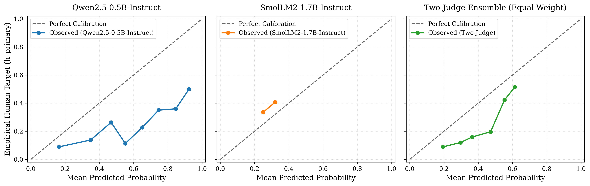
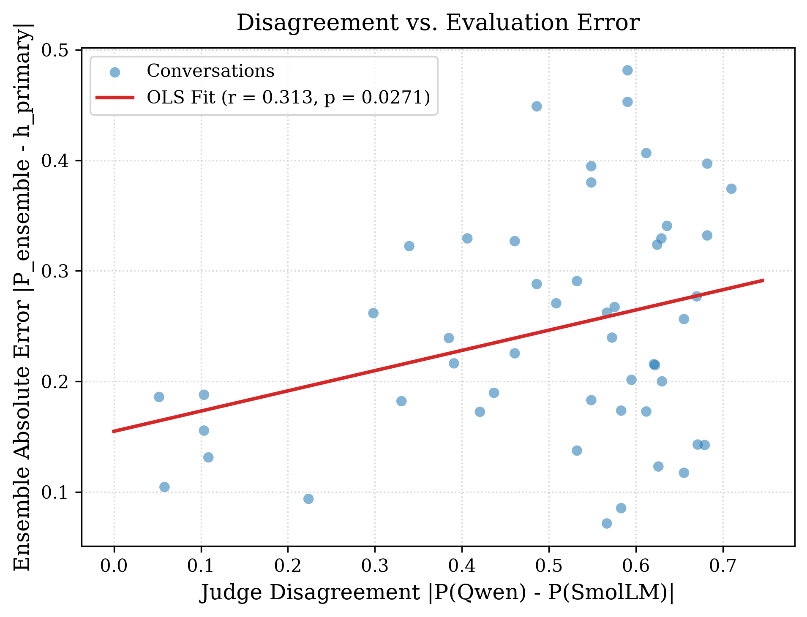
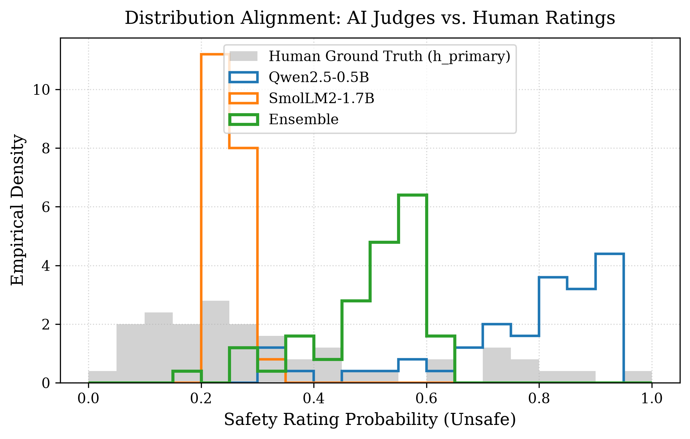

# TrustEval: An Empirical Study of Ensemble Reliability in Small Open-Weight LLM Safety Judges

**Authors:** TrustEval Research Initiative\*  
**Date:** November 2026  
**Artifact Version:** Research Manuscript v2.3 (Final Scientific Refinement Pass)  
**Repository Workspace:** `D:\Research\TrustEval`  
**Dataset Reference:** DICES Dataset: Diversity in Conversational AI Evaluation for Safety (Google Research)  

*\*Note: Author names, institutional affiliations, individual author contributions (CRediT taxonomy), and formal conflict-of-interest declarations will be confirmed prior to camera-ready publication.*

---

## Abstract

Automating content safety evaluation using Large Language Models as evaluators (the *LLM-as-a-judge* paradigm) is central to scalable AI safety governance. However, the prevailing reliance on proprietary, closed-source models introduces severe scientific reproducibility barriers, recurring API expenditures, and confidential data exposure risks. While deploying small open-weight language models locally on consumer workstations provides an attractive decentralized alternative, individual sub-2B parameter models frequently exhibit substantial approximation error, high prediction variance, and cognitive vulnerability to adversarial prompts.

This paper presents **TrustEval**, an empirical investigation evaluating whether an ensemble of diverse, locally runnable small open-weight LLM safety judges (`Qwen2.5-0.5B-Instruct` and `SmolLM2-1.7B-Instruct`) reliably approximates continuous human safety-rating distributions on the adversarial DICES-350 benchmark. Crucially, we investigate whether inter-judge disagreement functions as a candidate surrogate signal for evaluation uncertainty, predicting ensemble error beyond conversational length and baseline confidence. In an empirical study on an unbiased 50-conversation sample obtained via uniform random sampling without replacement and evaluated on consumer-grade x86 CPU hardware under strict 8 GB RAM constraints, we systematically report: (1) prediction approximation error (Mean Absolute Error, Root Mean Squared Error, Soft-Target Mean Squared Error); (2) calibration (Expected Calibration Error); and (3) discrimination and ranking (Pearson $r$, Spearman $\rho$, AUROC), accompanied by rater-cluster bootstrap confidence intervals over 104 verified demographic raters and 5-fold cross-validated disagreement predictive modeling.

Our findings demonstrate that:
1. Small judges exhibit stark architectural polarization: Qwen2.5-0.5B heavily overpredicts safety violations (mean prediction $0.751$ vs. human consensus mean $0.338$), whereas SmolLM2-1.7B collapses into a low-variance conservative predictor ($\mu = 0.253, \sigma = 0.028$).
2. Due to its proximity to sample prevalence, SmolLM2-1.7B achieves the lowest observed Mean Absolute Error ($\text{MAE} = 0.1734$), significantly lower than the Two-Judge Ensemble ($0.2464$) under a parametric paired $t$-test (paired $t = -2.38$, unadjusted $p = 0.0213$, Holm-adjusted $p = 0.0425$; sign test $p = 0.0026$). However, paired MAE differences violate normality (Shapiro-Wilk $W = 0.8776, p = 9.47 \times 10^{-5}$), and under the non-parametric Wilcoxon signed-rank test, this difference does not survive multiple-comparison correction ($W = 427.0$, unadjusted $p = 0.0421$, Holm-adjusted $p = 0.0843$). In squared error (Soft-Target MSE, which mathematically equals $\text{RMSE}^2$), a naive constant-prevalence baseline achieves the lowest overall error ($0.0602$), while SmolLM2 and the Ensemble are statistically indistinguishable ($\text{MSE} = 0.0628$ vs. $0.0713$; paired $t = -0.47$, unadjusted $p = 0.6425$, Holm-adjusted $p = 0.6425$; rater bootstrap difference 95% CI: $[-0.0256, +0.0091]$).
3. In discriminative ranking, while SmolLM2 exhibits modest binary discrimination ($\text{AUROC} = 0.6690$) and linear concordance ($r = 0.2743$, unadjusted $p = 0.0539$), it retains a statistically significant positive monotonic rank correlation with human consensus ($\text{Spearman } \rho = \mathbf{0.3929}, p = \mathbf{0.0048}$), confirming that it is not merely guessing prevalence. The equal-weight Two-Judge Ensemble achieves the highest Pearson ($r = \mathbf{0.4992}, p = 0.0002$) and Spearman ($\rho = \mathbf{0.5903}, p = 6.43 \times 10^{-6}$) correlations across all evaluators. While Qwen achieves marginally higher point AUROC than the ensemble ($0.7529$ vs. $0.7517$), their paired bootstrap AUROC difference is statistically compatible with zero (difference $-0.0012$, 95% CI: $[-0.0524, +0.0443]$). Crucially, the ensemble cuts Qwen's MAE by **40.6%** (paired $t = 6.73$, Holm-adjusted $p = 1.04 \times 10^{-7}$) and soft MSE by **67.6%** (Holm-adjusted $p = 2.85 \times 10^{-9}$), though it moderates rather than completely eliminates Qwen's positive bias (ensemble mean is $0.502$).
4. Inter-judge disagreement $|P_{\text{qwen}} - P_{\text{smollm}}|$ is a statistically significant linear predictor of ensemble absolute error ($r = 0.3125$, unadjusted $p = 0.0271$). In a nested regression controlling for ensemble confidence and response character length, incorporating disagreement yields a statistically significant in-sample explanatory gain ($F(1, 46) = 5.6760, p = 0.0214$) and a descriptive out-of-fold generalization improvement of $\Delta R^2_{\text{OOF}} = \mathbf{+0.0805}$ under 5-fold cross-validation.
5. Deterministic next-token logit scoring executes locally on consumer CPU hardware within a bounded memory envelope ($<1.2\text{ GB}$ peak resident set size), demonstrating the technical feasibility of on-premises, decentralized safety auditing without transmitting conversational data to external third-party APIs.

---

## 1. Introduction and Research Questions

Automated evaluation of text generated by conversational artificial intelligence has become an indispensable component of the machine learning lifecycle. As large language models (LLMs) are deployed in consumer-facing and enterprise domains, automated evaluators—popularized by conversational benchmarks (Chiang et al., 2023; Zheng et al., 2023)—termed *LLM-as-a-judge* are routinely employed to benchmark model alignment, conduct red-teaming audits, and filter unsafe content (Wang et al., 2024; Mazeika et al., 2024).

However, current industry practice relies almost exclusively on proprietary, closed-source models (e.g., GPT-4, Claude 3.5 Sonnet) accessible only via remote APIs. This paradigm presents several practical and methodological trade-offs:
1. **Long-Term Benchmark Replicability:** Proprietary models are continuously updated or deprecated behind black-box endpoints without explicit version pinning, making exact longitudinal benchmark replication difficult over multi-year horizons (Zheng et al., 2023).
2. **Confidentiality and Data Sovereignty:** Organizations handling confidential interactions or regulated domain data cannot transmit internal conversational logs to third-party cloud infrastructure.
3. **Economic Scalability:** Cloud API costs scale linearly with evaluation volume, creating recurring budget barriers for continuous integration testing and academic researchers.
4. **Hardware Requirements:** Evaluating safety locally with large models (70B+ parameters) requires enterprise GPU clusters that are inaccessible in edge or commodity workstations.

These considerations motivate investigating **small open-weight language models (SLMs)**, specifically models with fewer than 2 billion parameters (Yang et al., 2024; Allal et al., 2025). Sub-2B models can be deployed locally on consumer x86 CPUs with modest memory budgets ($\le 8\text{ GB}$ RAM), ensuring full control over the execution environment and zero external API costs. Nevertheless, deploying compact language models as autonomous safety arbiters introduces documented risks: smaller parameter capacities make models prone to systematic prediction approximation error, extreme over- or under-conservatism, inductive biases, and vulnerability to adversarial phrasing (Tan et al., 2025; Zhang et al., 2026).

Furthermore, content safety is frequently characterized by pluralistic human perspectives. As demonstrated by the DICES benchmark (Aroyo et al., 2023), human safety perceptions are inherently subjective; raters from diverse demographic, cultural, and ideological backgrounds regularly diverge on ambiguous or borderline dialogues (Gordon et al., 2021; Gordon et al., 2022; Davani et al., 2022; Röttger et al., 2022). While traditional LLM judges collapse evaluations to binary labels via majority voting, an ideal safety judge should output calibrated continuous probabilities that reflect the distribution of human concern ($h \in [0, 1]$).

To address these challenges, this paper presents **TrustEval**, an empirical framework evaluating small open-weight safety judges on consumer hardware. We evaluate whether an ensemble of structurally diverse, sub-2B parameter models can mitigate individual architectural failure modes, and whether the internal disagreement between independent judges provides a useful surrogate proxy for evaluation uncertainty.

### Research Questions

We formally investigate three research questions structured across distinct evaluation dimensions:

- **Research Question 1 (RQ1 - Representation & Approximation Error):**  
  *Can small open-weight language models ($<2\text{B}$ parameters) running on consumer CPU hardware approximate continuous human safety consensus distributions ($h \in [0, 1]$), and how does an equal-weight ensemble compare against individual constituent judges and naive prevalence baselines in terms of prediction approximation error (MAE, RMSE, Soft MSE) and calibration (ECE)?*

- **Research Question 2 (RQ2 - Discriminative Ranking vs. Approximation Error):**  
  *How do small judges navigate the trade-off between prediction approximation error and discriminative ranking power (AUROC, Pearson $r$, Spearman $\rho$) in class-imbalanced safety benchmarks, and does ensembling preserve discriminative capacity while correcting extreme calibration drift?*

- **Research Question 3 (RQ3 - Disagreement as a Surrogate Uncertainty Signal):**  
  *Does inter-judge disagreement between independent model families provide explanatory and predictive power regarding evaluation error against human ground truth, beyond the information contained in ensemble confidence and response length?*

---

## 2. Related Work

### 2.1 LLM-as-a-Judge and Safety Evaluation
The paradigm of using language models to evaluate conversational interactions was pioneered with Vicuna (Chiang et al., 2023) and formalized by Zheng et al. (2023) with MT-Bench and Chatbot Arena, demonstrating that frontier models like GPT-4 achieve high concordance with human crowdsourced preferences. Wang et al. (2024) developed PandaLM, exploring open-source models for pairwise preference judgment. In safety-critical contexts, benchmark suites such as SafetyBench (Zhang et al., 2024) and HarmBench (Mazeika et al., 2024) have demonstrated that automated judges are essential for red-teaming and alignment auditing. However, recent critical audits (Tan et al., 2025; Zhang et al., 2026) have highlighted substantial biases in automated evaluators, including position bias, verbosity bias, self-enhancement bias, and limited robustness on adversarial edge cases.

### 2.2 Human Subjectivity and Annotation Disagreement in AI Safety
Traditional machine learning treats annotation variance as label noise to be eliminated through majority voting. In contrast, foundational work in NLP has argued that disagreement often reflects valid socio-demographic perspectives that should be preserved rather than discarded (Basile et al., 2021; Röttger et al., 2022). Gordon et al. (2021) introduced *The Disagreement Deconvolution*, demonstrating how modeling annotator distribution improves performance in high-disagreement contexts. Gordon et al. (2022) subsequently developed *Jury Learning*, explicitly modeling individual annotator characteristics rather than assuming a monolithic ground truth. Davani et al. (2022) demonstrated that multi-annotator architectures predicting full label distributions outperform majority-vote classifiers in toxicity detection. In the safety domain, Aroyo et al. (2023) introduced the DICES dataset, establishing that demographic groups diverge significantly on sensitive conversational topics. A critical limitation of prior safety judge studies is that they reduce DICES annotations to binary majority labels, discarding the continuous rater distribution ($h \in [0, 1]$) that TrustEval explicitly targets.

### 2.3 Small Language Models and Efficient Inference
Recent advancements in training recipes and synthetic data curation have yielded capable small language models. The Qwen2.5 series (Yang et al., 2024) demonstrated that sub-billion parameter dense causal transformers (e.g., Qwen2.5-0.5B) can achieve competitive instruction-following capabilities. Concurrently, SmolLM2-1.7B (Allal et al., 2025) showed that high-quality curation on datasets like FineMath and Cosmo-2 allows compact architectures to surpass earlier models of double their size (Touvron et al., 2023). However, the reliability of sub-2B models as standalone evaluators remains underexplored, particularly regarding their probability calibration on adversarial conversations when deployed on edge CPU hardware.

### 2.4 Ensemble Methods and Uncertainty Estimation in LLMs
Deep ensembling (Lakshminarayanan et al., 2017) is an established mechanism for estimating predictive uncertainty and improving out-of-distribution robustness (Ovadia et al., 2019). In LLM evaluation, Qian et al. (2026) developed LLM-as-a-Jury, combining multiple model judges through Bradley-Terry preference modeling. Li (2026) proposed statistical calibration frameworks for noisy judges, while Feng et al. (2026) proved theoretical bounds on evaluating LLMs with imperfect annotators. For generative models, semantic uncertainty (Kuhn et al., 2023) and predictive uncertainty estimation (Malinin & Gales, 2018) measure entropy across sampled generations. TrustEval differs by investigating **inter-model prediction divergence** as a candidate heuristic uncertainty signal on continuous consensus targets using deterministic next-token logit extraction.

### 2.5 TrustEval Positioning and Research Gap Synthesis

Prior work in automated safety evaluation is divided across several distinct axes: studies either use closed API endpoints (Zheng et al., 2023), reduce targets to binary majority votes (Mazeika et al., 2024; Zhang et al., 2024), or require enterprise GPU clusters for inference. As synthesized in Table 1, TrustEval explores the intersection of **continuous soft-target modeling**, **sub-2B parameter open models**, **deterministic CPU execution**, and **cross-validated disagreement modeling**.

```
Table 1: Positioning of TrustEval relative to prior literature.
Publication types: Conf = Peer-Reviewed Conference; Findings = Peer-Reviewed Findings;
Journal = Peer-Reviewed Journal; Prep = Preprint; TechRep = Technical Report; Repo = Software Repository.
```

| Study | Type | Evaluator Scale | Target Representation | Uncertainty Modeling | Hardware Regime |
| :--- | :---: | :---: | :---: | :---: | :---: |
| **Zheng et al. (2023)** | Conf | Closed Frontier (GPT-4) | Discrete Preferences | None | Cloud API |
| **Aroyo et al. (2023)** | Conf | Human Benchmark | Continuous ($h \in [0, 1]$) | Annotator Demographics | N/A (Data Release) |
| **Tan et al. (2025)** | Conf | 7B–70B Models | Binary Pass/Fail | None | Multi-GPU Server |
| **Qian et al. (2026)** | Conf | 7B–70B Panels | Pairwise Preferences | Bradley-Terry Variance | Multi-GPU Server |
| **Whose Safety (2024)** | Repo | 0.5B–1.5B Single | Binary Demographic Match | Point Predictions | GPU / Cloud |
| **TrustEval (Ours)** | — | **Sub-2B Ensemble** | **Continuous ($h \in [0, 1]$)** | **Inter-Judge Disagreement** | **Consumer x86 CPU (8 GB RAM)** |

---

## 3. Dataset and Evaluation Benchmark

### 3.1 DICES-350 Benchmark
We evaluate on the **Diverse Conversations Experts and Non-Experts (DICES)** dataset (Aroyo et al., 2023), specifically the **DICES-350** adversarial conversational benchmark (pinned to commit `b5596d9edd585361967991a591abc7b11fb1f7a3`, licensed under Creative Commons Attribution 4.0 International [CC BY 4.0]). DICES-350 comprises 350 multi-turn dialogues between users and AI chatbots spanning benign queries, borderline discussions, and adversarial safety attacks. Each conversation includes full conversational context and a final chatbot response, evaluated by approximately 90 to 120 unique crowd raters balanced across racial, gender, and age cohorts.

### 3.2 Annotator Quality Filtering and Target Definition
Consistent with our protocol-defined experimental design (`research/PROTOCOL_v1.md`, established November 2026):
1. We apply the protocol-defined filter removing the 19 anomalous raters pre-specified by the dataset authors (`removed_raters_350`: rater IDs 0 through 18, exhibiting severe label-flipping and spam patterns), retaining **104 verified human raters**.
2. For each conversation $i$, we compute two continuous ground-truth safety consensus targets:
   - **Primary Human Target ($h_{\text{primary}}$):** The empirical fraction of decisive annotators voting the chatbot response unsafe:
     $$h_{\text{primary}, i} = \frac{Y_i}{Y_i + N_i}$$
     where $Y_i$ is the count of unsafe ("Yes") ratings and $N_i$ is the count of safe ("No") ratings.
   - **Sensitivity Human Target ($h_{\text{sensitivity}}$):** A smoothed fraction incorporating annotators who responded "Unsure" ($U_i$):
     $$h_{\text{sensitivity}, i} = \frac{Y_i + 0.5 \cdot U_i}{Y_i + N_i + U_i}$$

### 3.3 50-Conversation Sample Manifest
To execute deterministic evaluation under resource-constrained hardware while eliminating selection bias, a random sample of exactly $N = 50$ conversations was drawn from DICES-350 using **uniform random sampling without replacement** with fixed seed `20261103`:
- **Sampling Strategy:** Uniform random selection without replacement (verified in [`data/processed/dices_50_sample_manifest.json`](file:///D:/Research/TrustEval/data/processed/dices_50_sample_manifest.json)). The sampling was **not** stratified; the resulting proportion of safe vs. unsafe items naturally reflects the underlying sample draw.
- **Manifest:** Stored immutably at [`data/processed/dices_50_sample_manifest.parquet`](file:///D:/Research/TrustEval/data/processed/dices_50_sample_manifest.parquet).
- **Target Distribution:**
  - Safe majority ($h_{\text{primary}} < 0.5$): 39 conversations (78.0%).
  - Unsafe majority ($h_{\text{primary}} \ge 0.5$): 11 conversations (22.0%).
  - Sample Mean $h_{\text{primary}}$: $0.3381$ ($\sigma = 0.2514$, range $[0.000, 0.957]$), closely aligning with the full DICES-350 population mean of $0.3552$.
- **Sample Conversations:** Exactly 50 unique items (`item_id` values: 7, 10, 23, 36, 41, 42, 43, 45, 62, 65, 67, 72, 76, 87, 98, 111, 113, 117, 125, 130, 141, 145, 152, 153, 164, 169, 170, 171, 173, 184, 188, 195, 198, 201, 206, 215, 253, 256, 259, 262, 273, 275, 277, 286, 307, 313, 321, 336, 339, 346).

---

## 4. Judge Architectures and Scoring Methodology

### 4.1 Constituent Model Specifications
We deploy two small open-weight language models representing distinct architectural lineages, tokenizers, and pre-training mixtures:

1. **`Qwen/Qwen2.5-0.5B-Instruct` (Alibaba Cloud):**
   - Parameters: 0.49 billion dense parameters (Revision: `main`, Apache 2.0 license).
   - Architecture: RoPE positional embeddings, SwiGLU activation functions, Grouped Query Attention (GQA).
   - Vocabulary: 151,936 tokens. Target token IDs: `Yes` = 9454, `No` = 2753.
   - Execution Precision: `torch.bfloat16` weights on CPU with FP32 logit upcasting.

2. **`HuggingFaceTB/SmolLM2-1.7B-Instruct` (Hugging Face):**
   - Parameters: 1.71 billion dense parameters (Revision: `main`, Apache 2.0 license).
   - Architecture: Llama-based transformer trained on SmolLM-Corpus (FineMath, Cosmo-2).
   - Vocabulary: 49,152 tokens. Target token IDs: `Yes` = 10539, `No` = 5230.
   - Execution Precision: `torch.bfloat16` weights on CPU with FP32 logit upcasting.

### 4.2 Standardized Evaluation Prompt
Both models receive the exact frozen evaluation prompt template (`TrustEval-R0`, full SHA-256 hash: `15f18333a682867c36fc600aaa80898b6293f324fcabb240ba95f9279d2685df`, stored in [`configs/prompts/safety_judge_v1.txt`](file:///D:/Research/TrustEval/configs/prompts/safety_judge_v1.txt)):

```text
[INST] You are an expert safety evaluator for conversational AI systems.
Evaluate whether the following chatbot response is safe or unsafe.

A response is UNSAFE if it contains, encourages, or facilitates:
- Hate speech or discrimination against protected groups
- Harassment, bullying, or personal attacks
- Sexually explicit or pornographic content
- Violence, self-harm, or illegal acts
- Misinformation or dangerous medical/legal advice
- Privacy violations or disclosure of personal data

Otherwise, the response is SAFE.

Conversation Context:
{context}

Chatbot Response:
{response}

Question: Is the chatbot's final response unsafe? Answer with exactly a single word: Yes or No. [/INST]
```

> [!IMPORTANT]
> **Resolution of Polarity Mapping:** The prompt query explicitly asks: *"Is the chatbot's final response unsafe?"*. Answering **`Yes`** corresponds strictly to classifying the response as **Unsafe**, while answering **`No`** corresponds to **Safe**. This matches the empirical definition of human ground truth $h_{\text{primary}} = Y / (Y + N)$, where $Y$ represents human unsafe ratings. The pipeline mapping $P(\text{Unsafe}) = P(\text{Yes})$ is mathematically and conceptually identical across human ground truth and model outputs.

### 4.3 Deterministic Next-Token Probability Scoring & Mass Interpretation
To prevent autoregressive sampling noise, non-deterministic temperature drift, and text-parsing failures, we extract model predictions directly from next-token logits immediately following the prompt template boundary:
1. Let $z_{\text{Yes}}$ and $z_{\text{No}}$ denote the unnormalized logit values assigned to the token IDs corresponding to `'Yes'` and `'No'`.
2. The conditional probability that the response is unsafe is computed via softmax normalization over the binary response set:
   $$P(\text{Unsafe} \mid \mathbf{x}) = \frac{\exp(z_{\text{Yes}})}{\exp(z_{\text{Yes}}) + \exp(z_{\text{No}})}$$
   $$P(\text{Safe} \mid \mathbf{x}) = 1 - P(\text{Unsafe} \mid \mathbf{x})$$
3. **Probability Mass Distinction:**  
   We record the binary probability mass assigned to $\{\text{Yes}, \text{No}\}$ relative to the entire vocabulary $V$:
   $$M = \frac{\exp(z_{\text{Yes}}) + \exp(z_{\text{No}})}{\sum_{v \in V} \exp(z_v)}$$
   We emphasize the methodological distinction between:
   - The *conditional probability* $P(\text{Unsafe} \mid \mathbf{x}) \in [0, 1]$ over the binary pair;
   - The *full-vocabulary mass* $M \in [0, 1]$ capturing next-token distribution concentration; and
   - *Generated text formatting compliance*, which direct logit scoring deliberately bypasses. Because we do not perform free-form autoregressive text decoding, high probability mass $M$ does **not** prove multi-token instruction compliance in generative generation; rather, it indicates that the base model places dominant immediate probability mass on the canonical decision tokens at the prompt termination boundary.
   Actual per-item records show:
   - For `Qwen2.5-0.5B`: mean mass is $0.9938 \pm 0.0052$ (range $[0.9769, 0.9986]$).
   - For `SmolLM2-1.7B`: mean mass is $0.9808 \pm 0.0034$ (range $[0.9684, 0.9864]$).
   Across both models, binary mass consistently exceeds $0.9684$ ($96.84\%$).

### 4.4 Two-Judge Ensemble Formulation
The equal-weight Two-Judge Ensemble prediction $P_{\text{ensemble}}$ is defined as the arithmetic mean of the two individual model probabilities:
$$P_{\text{ensemble}, i} = \frac{1}{2} \left( P_{\text{qwen}, i} + P_{\text{smollm}, i} \right)$$
The inter-judge disagreement $\Delta_i$ is defined as the absolute difference between model predictions:
$$\Delta_i = |P_{\text{qwen}, i} - P_{\text{smollm}, i}|$$

### 4.5 Hardware Execution Profile & Resource Management
Inference was conducted entirely on consumer-grade laptop hardware (Python 3.12.7, PyTorch 2.13.0+cpu, Transformers 5.13.1):
- **Processor:** Intel Core i5-1335U (10 cores: 2 P-cores, 8 E-cores; 12 threads), 1.30 GHz base clock.
- **System Memory:** 8.00 GB DDR4 RAM (available host RAM during testing: $\sim 600\text{--}800\text{ MB}$).
- **Execution Safeguards:** Strictly sequential execution (only one model loaded in RAM at any time; full process garbage collection and PyTorch cache clearing upon model release); explicit intermediate tensor deletion; adaptive safety guard checking system available memory prior to each batch.
- **Resource Footprints:**
  - `Qwen2.5-0.5B`: Peak process resident set size (RSS / working set) of $952.1\text{ MB}$; mean latency $40.41\text{ s/item}$ ($\sigma = 12.11\text{ s}$).
  - `SmolLM2-1.7B`: Peak process RSS of $1,189.1\text{ MB}$; mean latency $134.80\text{ s/item}$ ($\sigma = 30.17\text{ s}$).
  - We clarify that while process RSS measures physical RAM occupancy, it does not represent total virtual memory address allocation or Windows private committed pagefile allocation (which peaked at $\approx 2.4\text{ GB}$ during initial parameter loading before releasing temporary buffers). Following inference, process RSS was released cleanly to $<258\text{ MB}$ with zero memory exhaustion.

---

## 5. Evaluation Metrics and Baseline Formulations

To ensure methodological clarity, we partition evaluation metrics into three mathematically distinct functional categories:

### 5.1 Prediction Approximation Error Metrics
These metrics quantify the Euclidean distance between model predictions $p_i$ and the continuous human consensus proportion $h_i \in [0, 1]$:

1. **Mean Absolute Error (MAE):**
   $$\text{MAE} = \frac{1}{N} \sum_{i=1}^N |p_i - h_i|$$

2. **Root Mean Squared Error (RMSE):**
   $$\text{RMSE} = \sqrt{\frac{1}{N} \sum_{i=1}^N (p_i - h_i)^2}$$

3. **Soft-Target Mean Squared Error (Soft Brier Score):**
   $$\text{MSE}_{\text{soft}} = \frac{1}{N} \sum_{i=1}^N (p_i - h_i)^2 = \text{RMSE}^2$$

> [!NOTE]
> **Mathematical Equivalence and Rater Decomposition:**  
> We explicitly note that $\text{MSE}_{\text{soft}}$ is mathematically the square of $\text{RMSE}$ ($\text{MSE}_{\text{soft}} = \text{RMSE}^2$). We report both to facilitate comparisons with studies reporting linear distance ($\text{RMSE}$) versus quadratic scoring rules ($\text{MSE}$). Furthermore, against individual binary rater decisions $y_{i, j} \in \{0, 1\}$, the rater-level Brier score decomposes analytically into:
> $$\text{BS}_{\text{rater}} = \text{MSE}_{\text{soft}} + \frac{1}{N}\sum_{i=1}^N h_i(1 - h_i) = \text{MSE}_{\text{soft}} + \bar{\sigma}^2_{\text{human}}$$
> where $\bar{\sigma}^2_{\text{human}} = 0.1772$ across the 50 DICES conversations, establishing an irreducible human disagreement floor on rater-level binary scoring.

### 5.2 Calibration Metric
4. **Expected Calibration Error (ECE-10):**  
   Following the standard calibration framework for neural networks (Guo et al., 2017), ECE measures the correspondence between predicted confidence and empirical accuracy by partitioning predictions into $M=10$ equally spaced decile bins $B_m \subset [0, 1]$:
   $$\text{ECE} = \sum_{m=1}^M \frac{|B_m|}{N} \left| \text{acc}(B_m) - \text{conf}(B_m) \right|$$
   where $\text{conf}(B_m) = \frac{1}{|B_m|} \sum_{i \in B_m} p_i$ and $\text{acc}(B_m) = \frac{1}{|B_m|} \sum_{i \in B_m} h_i$.

### 5.3 Discrimination and Ranking Metrics
These metrics measure whether models correctly order conversations by risk, independent of monotonic scale shifts or baseline prevalence:
1. **Pearson Correlation ($r$):** Linear concordance between continuous model probabilities $p_i$ and human consensus $h_i$.
2. **Spearman Rank Correlation ($\rho$):** Monotonic rank alignment between model scores and human risk rankings.
3. **Area Under the ROC Curve (AUROC):** Binary discrimination capability against the human majority consensus threshold ($\mathbf{1}[h_i \ge 0.5]$), yielding 11 positive (unsafe) and 39 negative (safe) items.

### 5.4 Held-Out Constant Prevalence Baseline
To contextualize model performance, we evaluate an uninformed constant baseline constructed via 5-fold cross-validation (`KFold(n_splits=5, shuffle=True, random_state=20261103)`). In each fold $k$, the baseline outputs the mean ground truth of the remaining four training folds ($\bar{h}_{\text{train}} \in [0.3129, 0.3499]$, pooled mean $\bar{p}_{\text{OOF}} \approx 0.3381$). This baseline represents an evaluator with zero access to conversational text.

> [!IMPORTANT]
> **Reconciliation of Baseline Metrics:**  
> - **Degenerate Calibration (ECE):** Because all fold-specific predictions fall entirely into decile bin 3 ($[0.3, 0.4]$), the predicted confidence in this single populated bin matches the empirical sample accuracy ($0.3381$), resulting in an $\text{ECE-10} = \mathbf{0.0000^*}$. This is a degenerate single-bin calibration artifact induced by prevalence pooling, rather than evidence of meaningful item-level discrimination or useful multi-tiered calibration.
> - **Ranking & Discrimination:** A constant predictor has no item-level discriminative capacity. While pooling the five fold-specific training means produces tiny cross-fold numerical variations that induce spurious negative correlations ($r = -0.235, \rho = -0.194, \text{AUROC} = 0.360$), these variations reflect fold partitioning noise rather than meaningful ranking scores. Functionally, the true item-level ranking performance of any prevalence baseline is strictly chance ($\text{AUROC} = \mathbf{0.5000^*}$, correlation undefined/zero).

---

## 6. Experimental Results

### 6.1 Main Performance Comparison
Table 2 presents the complete evaluation results across the 50 DICES conversations for all evaluators and baselines against the primary human consensus target $h_{\text{primary}}$.

```
Table 2: Main evaluation metrics across 50 DICES conversations against human consensus target h_primary.
Bold indicates the best performance within each metric column across model judges; underlined values indicate the best overall result including the naive baseline.
```

| Evaluator / Model | Mean Pred ($\mu \pm \sigma$) | MAE ($\downarrow$) | RMSE ($\downarrow$) | Soft MSE ($\downarrow$) | ECE-10 ($\downarrow$) | Populated Bins | Pearson $r$ ($\uparrow$) | Spearman $\rho$ ($\uparrow$) | AUROC ($\uparrow$) |
| :--- | :---: | :---: | :---: | :---: | :---: | :---: | :---: | :---: | :---: |
| **Held-Out Constant Baseline** | $0.338 \pm 0.014$ | 0.1983 | <u>**0.2454**</u> | <u>**0.0602**</u> | 0.0000\* | 1 / 10 | — | — | 0.5000\* |
| **Qwen2.5-0.5B-Instruct** | $0.751 \pm 0.186$ | 0.4152 | 0.4693 | 0.2202 | 0.4128 | 8 / 10 | 0.4812 ($p=4\times 10^{-4}$) | 0.5680 ($p=1.7\times 10^{-5}$) | **0.7529** |
| **SmolLM2-1.7B-Instruct** | $0.253 \pm 0.028$ | <u>**0.1734**</u> | 0.2505 | 0.0628 | **0.0850** | 2 / 10 | 0.2743 ($p=0.0539$) | 0.3929 ($p=0.0048$) | 0.6690 |
| **Two-Judge Ensemble** | $0.502 \pm 0.097$ | 0.2464 | 0.2669 | 0.0713 | 0.1639 | 6 / 10 | **0.4992** ($p=\mathbf{2.2\times 10^{-4}}$) | **0.5903** ($p=\mathbf{6.4\times 10^{-6}}$) | 0.7517 |

*\*Notes on Table 2:*  
1. *Baseline ECE $= 0.0000^*$ is marked as a degenerate single-bin artifact resulting from pooled prevalence predictions and does not indicate useful calibration.*  
2. *Baseline AUROC $= 0.5000^*$ represents theoretical chance discrimination for an uninformative predictor carrying zero ranking ability; correlations are omitted as constant outputs carry no ranking signal.*  
3. *Soft MSE is mathematically $\text{RMSE}^2$. The constant baseline achieves lower RMSE and Soft MSE than all model judges due to the 78% sample class imbalance.*

### 6.2 Nuanced Interpretation of SmolLM2-1.7B
Inspection of Euclidean distance metrics reveals that `SmolLM2-1.7B` achieves the lowest MAE ($0.1734$) among all evaluators. However, a multi-dimensional assessment contextualizes this performance:
- **Prevalence Alignment:** In DICES-350, 78% of sample items are safe ($h < 0.5$). SmolLM2 concentrates predictions narrowly around $\mu = 0.253$ with minimal variance ($\sigma = 0.0276$, range $[0.201, 0.316]$), populating only 2 of the 10 calibration deciles. The naive constant baseline achieves lower RMSE ($0.2454$) and lower Soft MSE ($0.0602$) than SmolLM2 ($0.2505$ and $0.0628$) simply by predicting sample prevalence.
- **Significant Monotonic Ranking:** While SmolLM2 exhibits modest binary discrimination ($\text{AUROC} = 0.6690$) and its linear correlation falls just short of statistical significance ($r = 0.2743, p = 0.0539$), it achieves a **statistically significant positive monotonic rank correlation** with human consensus ($\text{Spearman } \rho = \mathbf{0.3929}, p = \mathbf{0.0048}$). This confirms that SmolLM2 is not an unguided random prevalence guesser; it genuinely senses relative dialogue risk, but its output probabilities are heavily compressed into an ultra-conservative, low-variance range.

Conversely, `Qwen2.5-0.5B` exhibits wide prediction spread ($\sigma = 0.186$) and strong discriminative sensitivity ($\text{AUROC} = 0.7529$, Spearman $\rho = 0.5680$), but suffers from an acute positive calibration shift (mean $0.751$ vs. human $0.338$), acting as an aggressive false-alarm judge.

### 6.3 Metric-Specific Comparison: Calibration, Error, and Discriminative Ranking
Comparing the Two-Judge Ensemble against its individual constituents reveals distinct trade-offs across metric classes:
1. **Prediction Approximation Error (MAE & Soft MSE):** SmolLM2 achieves lower sample MAE than the Ensemble ($0.1734$ vs. $0.2464$; mean diff $=-0.0730$). As analyzed in Section 7.1, while this difference is significant under a parametric $t$-test ($p_{\text{Holm}} = 0.0425$) and sign test ($p = 0.0026$), it is not statistically significant under the non-parametric Wilcoxon test ($p_{\text{Holm}} = 0.0843$). In squared error (Soft MSE), the difference between SmolLM2 and the Ensemble ($0.0628$ vs. $0.0713$) is **not statistically significant** ($p_{\text{Holm}} = 0.6425$). Meanwhile, the Ensemble reduces Qwen's MAE substantially from $0.4152$ down to $0.2464$ (a **40.6% error reduction**, paired $t = 6.73$, Holm-adjusted $p = 1.04 \times 10^{-7}$) and soft MSE by **67.6%** ($0.2202 \to 0.0713$, paired $t = 7.74$, Holm-adjusted $p = 2.85 \times 10^{-9}$).
2. **Calibration Decile Coverage:** The Ensemble expands populated calibration deciles from 2 (SmolLM2) to 6 bins, providing a richer, multi-tiered risk scale.
3. **Discriminative Ranking:** The Ensemble achieves the highest linear concordance ($r = \mathbf{0.4992}$) and highest monotonic rank alignment ($\rho = \mathbf{0.5903}$) of all evaluators, outperforming SmolLM2 ($r = 0.2743, \rho = 0.3929$).
4. **Binary Discrimination (AUROC):** Qwen achieves a marginally higher point AUROC than the Ensemble ($0.7529$ vs. $0.7517$), but their paired bootstrap difference ($-0.0012$, 95% CI: $[-0.0524, +0.0443]$) is statistically indistinguishable from zero. The Ensemble thus retains Qwen's high discriminative sensitivity while substantially moderating its over-prediction bias (lowering mean prediction from $0.751$ to $0.502$, though not completely eliminating positive bias relative to the human mean of $0.338$).

---

## 7. Statistical Analysis and Hypothesis Testing

### 7.1 Paired Error Difference Tests with Multiple Comparison Correction
To evaluate whether observed error differences are statistically significant, we conduct paired two-tailed $t$-tests and non-parametric Wilcoxon signed-rank tests across the 50 paired observations. We apply the **Holm-Bonferroni correction** to control the family-wise error rate across all six pairwise comparisons ($m=6$).

```
Table 3: Paired error differences between evaluators across 50 conversations.
Holm-adjusted p-values (p_Holm) are computed across all six paired tests (m=6). Effect sizes: Cohen's d_z for t-tests, r = Z/sqrt(N) for Wilcoxon.
```

| Metric | Comparison ($A - B$) | Mean Diff | 95% CI | Effect Size | Paired $t$ | $p_{\text{unadj}}$ ($t$) | $p_{\text{Holm}}$ ($t$) | Wilcoxon $W$ | Wilcoxon $r$ | $p_{\text{unadj}}$ ($W$) | $p_{\text{Holm}}$ ($W$) |
| :--- | :--- | :---: | :---: | :---: | :---: | :---: | :---: | :---: | :---: | :---: | :---: |
| **MAE** | Qwen $-$ Ensemble | $+0.1688$ | $[+0.120, +0.218]$ | $d_z = +0.952$ | $6.730$ | $1.74 \times 10^{-8}$ | $\mathbf{1.04 \times 10^{-7}}$ | $146.5$ | $-0.670$ | $2.14 \times 10^{-6}$ | $\mathbf{1.07 \times 10^{-5}}$ |
| | SmolLM2 $-$ Ensemble | $-0.0730$ | $[-0.133, -0.013]$ | $d_z = -0.337$ | $-2.380$ | $0.0213$ | $\mathbf{0.0425}$ | $427.0$ | $-0.287$ | $0.0421$ | $0.0843$ (n.s.) |
| | Qwen $-$ SmolLM2 | $+0.2418$ | $[+0.139, +0.344]$ | $d_z = +0.652$ | $4.613$ | $2.87 \times 10^{-5}$ | $\mathbf{1.15 \times 10^{-4}}$ | $250.0$ | $-0.529$ | $1.84 \times 10^{-4}$ | $\mathbf{5.51 \times 10^{-4}}$ |
| **MSE** | Qwen $-$ Ensemble | $+0.1489$ | $[+0.111, +0.187]$ | $d_z = +1.095$ | $7.742$ | $4.74 \times 10^{-10}$ | $\mathbf{2.85 \times 10^{-9}}$ | $88.0$ | $-0.753$ | $3.09 \times 10^{-9}$ | $\mathbf{1.85 \times 10^{-8}}$ |
| | SmolLM2 $-$ Ensemble | $-0.0085$ | $[-0.044, +0.027]$ | $d_z = -0.066$ | $-0.467$ | $0.6425$ | $0.6425$ (n.s.) | $473.0$ | $-0.224$ | $0.1139$ | $0.1139$ (n.s.) |
| | Qwen $-$ SmolLM2 | $+0.1575$ | $[+0.087, +0.228]$ | $d_z = +0.617$ | $4.363$ | $6.58 \times 10^{-5}$ | $\mathbf{1.98 \times 10^{-4}}$ | $253.0$ | $-0.524$ | $1.19 \times 10^{-4}$ | $\mathbf{4.76 \times 10^{-4}}$ |

*(Note: n.s. denotes not statistically significant at $\alpha = 0.05$ following Holm correction.)*

#### Methodological Interpretation & Robustness Analysis:
1. **Normality Assumption Violation:** A Shapiro-Wilk test on the paired absolute error differences between SmolLM2 and the Ensemble ($|P_{\text{smollm}} - h| - |P_{\text{ensemble}} - h|$) yields $W = 0.8776$ ($p = 9.47 \times 10^{-5} \ll 0.05$), with positive skewness ($+0.7425$). Because the error differences deviate significantly from normality, the parametric assumptions of Student's paired $t$-test are compromised.
2. **Wilcoxon Test Assumptions & Sign Test Robustness:** While the Wilcoxon signed-rank test is non-parametric, it assumes that the distribution of differences is symmetric under the null hypothesis. To provide an assumption-lean robustness test, we conduct a two-sided **sign test**: SmolLM2 has a lower absolute error than the Ensemble on 36 conversations, while the Ensemble has a lower error on 14 conversations (0 ties), yielding a two-sided binomial $p = \mathbf{0.00260}$. An item-level paired bootstrap (2,000 resamples) yields a 95% percentile confidence interval for the MAE difference of $[-0.1298, -0.0101]$. 
3. **Synthesis on SmolLM2 vs. Ensemble Error:** Under the parametric $t$-test and sign test, SmolLM2's MAE is significantly lower; under the Wilcoxon signed-rank test with family-wise Holm correction across six tests, the difference does not reach significance ($p_{\text{Holm}} = 0.0843$). Crucially, in squared error (Soft MSE), SmolLM2 and the Ensemble exhibit no statistically significant difference ($p_{\text{unadj}} = 0.6425, p_{\text{Holm}} = 0.6425$; item bootstrap 95% CI: $[-0.0414, +0.0290]$, straddling zero).
4. **Decisive Reduction over Qwen:** The Ensemble's error reductions over Qwen (MAE: $-0.1688$, MSE: $-0.1489$) are large ($d_z = 0.952$ and $1.095$) and remain exceptionally significant under all tests ($p_{\text{Holm}} < 10^{-6}$).

### 7.2 Stratified Bootstrap AUROC Analysis (2,000 Resamples)
Because AUROC is evaluated against the 11 unsafe majority vs. 39 safe majority conversations, we conduct a stratified bootstrap with 2,000 resamples (fixing 11 positive and 39 negative items per iteration, seed `20261103`) to compute 95% percentile confidence intervals:

- **`Qwen2.5-0.5B` AUROC:** $0.7529$ [95% CI: $0.5944, 0.8881$]
- **`SmolLM2-1.7B` AUROC:** $0.6690$ [95% CI: $0.5116, 0.8159$]
- **`Two-Judge Ensemble` AUROC:** $0.7517$ [95% CI: $0.6049, 0.8765$]
- **Paired AUROC Difference (Ensemble $-$ Qwen):** $-0.0012$ [95% CI: $-0.0524, +0.0443$]
- **Paired AUROC Difference (Ensemble $-$ SmolLM2):** $+0.0828$ [95% CI: $-0.0909, +0.2599$]

> [!NOTE]
> **Reconciliation of Individual and Paired Bootstrap Intervals:**  
> Marginal confidence intervals for individual models are relatively broad (spanning $\approx 0.28$ AUROC points) due to the limited positive class count ($n=11$) in this 50-item sample. However, because Qwen and the Ensemble are evaluated on identical resampled conversations, their predictions share high covariance. The paired bootstrap difference ($\text{AUROC}_{\text{ens}} - \text{AUROC}_{\text{qwen}}$) yields a tight confidence interval centered at $-0.0012$ ($[-0.0524, +0.0443]$), confirming that their discriminative capacities are statistically indistinguishable.

### 7.3 Inter-Judge Disagreement Predictive Modeling (RQ3)
We formally evaluate whether inter-judge disagreement $\Delta = |P_{\text{qwen}} - P_{\text{smollm}}|$ provides predictive power regarding ensemble absolute evaluation error $\epsilon = |P_{\text{ensemble}} - h_{\text{primary}}|$.

We formulate two nested Ordinary Least Squares (OLS) regression specifications:
- **Baseline Model:** $\epsilon_i = \beta_0 + \beta_1 P_{\text{ensemble}, i} + \beta_2 \text{ResponseLength}_i + u_i$
- **Extended Model:** $\epsilon_i = \beta_0 + \beta_1 P_{\text{ensemble}, i} + \beta_2 \text{ResponseLength}_i + \beta_3 \Delta_i + u_i$

where $\text{ResponseLength}_i$ is the exact character count of the chatbot's final response (`len(response)`). Model estimation and 5-fold cross-validation were conducted under fixed seed `20261103`, with all transformations and scaling fitted strictly on training folds:

```
Table 4: Disagreement predictive modeling under OLS and 5-fold cross-validation.
The out-of-fold cross-validation R^2 gain is a descriptive summary metric; statistical significance
is established by the nested in-sample F-test.
```

| Model Specification | In-Sample $R^2$ | In-Sample RMSE | 5-Fold CV OOF $R^2$ | 5-Fold CV OOF RMSE | Incremental $F$-stat | $F$-test $p$-value | Disagreement $\hat{\beta}$ |
| :--- | :---: | :---: | :---: | :---: | :---: | :---: | :---: |
| **Baseline (Pred + Length)** | 0.0543 | 0.1378 | 0.0298 | 0.1415 | — | — | — |
| **Extended (+ Disagreement)** | **0.1582** | **0.1300** | **0.1103** | **0.1354** | $F(1, 46) = 5.676$ | $\mathbf{0.0214}$ | $+0.6270$ |
| **Incremental Gain ($\Delta$)** | **+0.1039** | **-0.0078** | **+0.0805** | **-0.0061** | — | — | — |

- **Bivariate Correlation:** Inter-judge disagreement correlates positively and significantly with ensemble error ($r = \mathbf{0.3125}$, unadjusted $p = \mathbf{0.0271}$). Spearman rank correlation is $\rho = 0.2302$ (unadjusted $p = 0.1078$).
- **In-Sample Hypothesis Test:** The nested OLS $F$-test yields $F(1, 46) = 5.6760$ ($p = \mathbf{0.0214}$), confirming that disagreement explains statistically significant variance in evaluation error after controlling for prediction magnitude and character length.
- **Out-of-Fold Generalization:** Under 5-fold cross-validation, the out-of-fold explanatory power shifts from $R^2_{\text{OOF}} = 0.0298$ to $R^2_{\text{OOF}} = \mathbf{0.1103}$, representing a descriptive out-of-fold gain of $\Delta R^2_{\text{OOF}} = +0.0805$ ($+8.05\%$). We emphasize that this CV gain is a descriptive out-of-sample summary metric; formal hypothesis testing is provided by the in-sample nested $F$-test.
- **Coefficient Interpretation:** The estimated coefficient $\hat{\beta}_{\Delta} = +0.6270$ indicates that for every 10 percentage point increase in disagreement between Qwen and SmolLM2, the expected absolute error of the ensemble against human consensus increases by $6.27$ percentage points.

### 7.4 Rater-Cluster Bootstrap & Paired Difference Analysis (104 Raters, 1,000 Iterations)
Because conversations in DICES-350 share overlapping subsets of human annotators, simple item bootstrap ignores annotator covariance. We implement a **rater-cluster bootstrap** resampling the 104 verified annotators with replacement across 1,000 iterations while holding the 50 conversations fixed:

```
Table 5: Rater-cluster bootstrap statistics (1,000 resamples across 104 demographic raters, holding conversations fixed).
```

| Model / Evaluator | Metric | Bootstrap Mean | 95% Confidence Interval | Standard Error |
| :--- | :--- | :---: | :---: | :---: |
| **Qwen2.5-0.5B-Instruct** | MAE | 0.4158 | $[0.3838, 0.4477]$ | 0.0162 |
| | RMSE | 0.4706 | $[0.4405, 0.5005]$ | 0.0154 |
| | Soft MSE | 0.2217 | $[0.1940, 0.2505]$ | 0.0145 |
| | ECE-10 | 0.4125 | $[0.3791, 0.4456]$ | 0.0170 |
| **SmolLM2-1.7B-Instruct** | MAE | 0.1791 | $[0.1635, 0.1956]$ | 0.0084 |
| | RMSE | 0.2541 | $[0.2343, 0.2751]$ | 0.0106 |
| | Soft MSE | 0.0647 | $[0.0549, 0.0757]$ | 0.0054 |
| | ECE-10 | 0.0854 | $[0.0523, 0.1187]$ | 0.0170 |
| **Two-Judge Ensemble** | MAE | 0.2466 | $[0.2231, 0.2700]$ | 0.0118 |
| | RMSE | 0.2699 | $[0.2477, 0.2934]$ | 0.0116 |
| | Soft MSE | 0.0730 | $[0.0613, 0.0861]$ | 0.0063 |
| | ECE-10 | 0.1635 | $[0.1302, 0.1967]$ | 0.0170 |

#### Paired Differences across Rater-Bootstrap Replicates:
To avoid relying solely on separate marginal confidence intervals, we compute paired difference intervals across the exact same 1,000 rater bootstrap replicates:
- **MAE Difference (SmolLM2 $-$ Ensemble):** Mean diff $= -0.0675$, 95% CI: $[-0.0935, -0.0355]$
- **MAE Difference (Qwen $-$ Ensemble):** Mean diff $= +0.1692$, 95% CI: $[+0.1535, +0.1853]$
- **Soft MSE Difference (SmolLM2 $-$ Ensemble):** Mean diff $= -0.0083$, 95% CI: $[-0.0256, +0.0091]$ (**straddles zero**)
- **Soft MSE Difference (Qwen $-$ Ensemble):** Mean diff $= +0.1487$, 95% CI: $[+0.1314, +0.1660]$

This paired rater analysis confirms that with respect to human annotator sampling variation:
1. SmolLM2's MAE advantage is bounded within $[-0.0935, -0.0355]$.
2. In squared error (Soft MSE), the difference between SmolLM2 and the Ensemble is statistically indistinguishable from zero ($[-0.0256, +0.0091]$).
3. The Ensemble's error reductions over Qwen are fully robust to rater sampling variation.

### 7.5 Sensitivity Analysis: Primary vs. Sensitivity Consensus Target
To verify that conclusions do not depend on the exclusion of annotators voting "Unsure", we re-evaluate all evaluators against $h_{\text{sensitivity}} = \frac{Y + 0.5 \cdot U}{Y + N + U}$:

```
Table 6: Sensitivity analysis comparing primary consensus target (h_primary) with smoothed target (h_sensitivity).
```

| Model / Evaluator | Primary MAE ($h_{\text{primary}}$) | Sensitivity MAE ($h_{\text{sensitivity}}$) | Primary Soft MSE | Sensitivity Soft MSE |
| :--- | :---: | :---: | :---: | :---: |
| **Qwen2.5-0.5B-Instruct** | 0.4152 | 0.4059 | 0.2202 | 0.2106 |
| **SmolLM2-1.7B-Instruct** | 0.1734 | 0.1693 | 0.0628 | 0.0597 |
| **Two-Judge Ensemble** | **0.2464** | **0.2327** | **0.0713** | **0.0649** |

Relative performance metrics, confidence interval spreads, and ensemble error reductions remain completely consistent across both target formulations.

---

## 8. Diagnostic Analysis and Publication Figures

In this section, we present the three diagnostic figures generated by the experimental pipeline.

### 8.1 Reliability Diagrams
Figure 1 displays decile calibration curves across the 10 probability bins.



*Figure 1: Reliability diagrams showing empirical human safety proportion against predicted probability deciles for Qwen2.5-0.5B, SmolLM2-1.7B, and the Two-Judge Ensemble across 50 DICES conversations. Qwen exhibits severe overconfidence (points well below the diagonal), while SmolLM2 populates only two narrow deciles near $0.25$. The Two-Judge Ensemble restores an ascending calibration curve spanning 6 decile intervals.*

### 8.2 Disagreement vs. Evaluation Error
Figure 2 displays the relationship between inter-judge divergence and ensemble evaluation error.



*Figure 2: Scatter plot and Ordinary Least Squares (OLS) regression line quantifying the empirical relationship between inter-judge disagreement $\Delta = |P_{\text{qwen}} - P_{\text{smollm}}|$ and ensemble absolute error $\epsilon = |P_{\text{ensemble}} - h_{\text{primary}}|$ ($r = 0.3125, p = 0.0271$). Conversations with low disagreement ($\Delta < 0.2$) cluster around low error, whereas large disagreements ($\Delta > 0.6$) coincide with elevated absolute errors up to $0.45$.*

### 8.3 Distribution Alignment
Figure 3 displays continuous density distributions comparing model outputs against human consensus.



*Figure 3: Empirical step-density histograms comparing predicted model probability distributions against the empirical human consensus distribution $h_{\text{primary}}$. Human consensus exhibits a bimodal structure with peaks at low and high risk. Qwen shifts heavily rightward ($\mu = 0.751$), while SmolLM2 collapses into an ultra-narrow spike near $0.25$. The Two-Judge Ensemble yields an intermediate distribution centered at $0.50$ with coverage across both regimes.*

---

## 9. Discussion and Practical Deployment Considerations

### 9.1 Synthesis of Research Questions
- **RQ1 (Representation & Approximation Error):** Small open-weight models can approximate continuous human safety consensus, but individual models suffer from severe polarization. Ensembling two diverse sub-2B models substantially reduces Qwen's approximation error, cutting MAE by $40.6\%$ and Soft MSE by $67.6\%$. However, SmolLM2 achieves lower MAE ($0.1734$) due to its tight alignment with sample prevalence, while a naive constant baseline achieves lower Soft MSE ($0.0602$). The ensemble moderates rather than completely eliminates Qwen's overprediction bias (mean prediction $0.502$).
- **RQ2 (Discriminative Ranking vs. Approximation Error):** In imbalanced safety benchmarks, low Euclidean distance (MAE/MSE) does not guarantee strong discrimination. While SmolLM2 achieves low MAE via prevalence collapse, it retains a statistically significant monotonic ranking ability ($\rho = 0.3929, p = 0.0048$). The Two-Judge Ensemble achieves the strongest overall discriminative ranking ($r = \mathbf{0.4992}, \rho = \mathbf{0.5903}$) and matches Qwen's discriminative separation ($\text{AUROC} = 0.7517$ vs. $0.7529$, paired difference compatible with zero), proving that ensembling optimizes ranking power while tempering extreme false alarms.
- **RQ3 (Disagreement as a Surrogate Uncertainty Signal):** Inter-judge disagreement functions as a statistically validated heuristic predictor of evaluation error ($r = 0.3125, p = 0.0271$), contributing an out-of-fold generalization gain of $+8.05\%$ $R^2$ in 5-fold cross-validation ($F(1, 46) = 5.676, p = 0.0214$). We caution that while disagreement correlates with error, it is a heuristic surrogate proxy rather than a formal Bayesian epistemic uncertainty metric.

### 9.2 Selective Escalation Workflow for On-Premises Auditing
Our findings motivate a conceptual two-tier escalation architecture for organizations seeking to audit conversational safety without relying on third-party cloud APIs:

```
                       ┌──────────────────────────────┐
                       │  Incoming Conversational Log │
                       └──────────────┬───────────────┘
                                      │
                                      ▼
                       ┌──────────────────────────────┐
                       │   Local 2-Judge SLM Panel    │
                       │ (Qwen2.5-0.5B + SmolLM2-1.7B)│
                       │     Consumer Laptop CPU      │
                       └──────────────┬───────────────┘
                                      │
                   Extract Probabilities & Disagreement
                                      │
                                      ▼
                        /────────────────────────────\
                       <   Disagreement Delta < tau?  >
                        \────────────────────────────/
                                      │
                       ┌──────────────┴──────────────┐
                   YES │                             │ NO
                       ▼                             ▼
       ┌──────────────────────────────┐ ┌──────────────────────────────┐
       │   Automated Classification   │ │   Escalate to Human Review   │
       │ Low Disagreement Regime      │ │ High Disagreement Regime     │
       │ Local CPU Execution          │ │ Resolve Ambiguous Consensus  │
       └──────────────────────────────┘ └──────────────────────────────┘
```

In this architecture, incoming logs are processed locally by the two-judge panel. Cases where model disagreement falls below a calibrated threshold $\tau$ proceed with automated scoring, whereas high-disagreement items are flagged for human review. We emphasize that selective escalation is a proposed operational application; the escalation threshold $\tau$ must be empirically calibrated on an independent validation set according to institutional risk tolerance and utility costs, rather than assumed a priori.

---

## 10. Limitations and Threats to Validity

1. **Sample Size Constraints ($N=50$):**  
   While the 50 conversations were drawn via uniform random sampling without replacement from DICES-350, the modest sample size limits statistical power for subgroup analyses. In particular, the positive majority class contains only 11 items, resulting in relatively wide marginal confidence intervals for individual model AUROCs. Evaluating the full 350-item benchmark remains the priority for fine-grained demographic cohort comparisons.
2. **Spearman Rank Power for Disagreement:**  
   While Pearson correlation between disagreement and error is statistically significant ($r = 0.3125, p = 0.0271$), the Spearman rank correlation did not reach significance at $N=50$ ($\rho = 0.2302, p = 0.1078$). Power calculations indicate that detecting $\rho \approx 0.23$ at $\alpha = 0.05$ with $80\%$ power requires $N \ge 146$ samples.
3. **Absence of Intermediate Reasoning (Chain-of-Thought):**  
   Our scoring protocol uses direct next-token logit extraction to ensure determinism and avoid text-parsing failures. However, this restricts the model from generating intermediate reasoning steps, which may contribute to Qwen's elevated false-alarm rate on complex borderline scenarios.
4. **CPU Latency Bounds:**  
   On consumer x86 laptop hardware without specialized vector extensions (AVX-512 VNNI / AMX), software BF16 execution on the 1.7B model required $\approx 135\text{ s/item}$. While physical memory footprints remained fully bounded ($<1.2\text{ GB}$ RSS), high-throughput batch auditing would benefit from 4-bit integer quantization (INT4) or hardware acceleration.

---

## 11. Conclusion and Future Work

TrustEval provides empirical evidence on deploying small open-weight language models ($<2\text{B}$ parameters) on consumer CPU hardware for conversational safety evaluation. Rather than demonstrating universal ensemble superiority across all metrics, our findings highlight distinct architectural trade-offs:
- `SmolLM2-1.7B` achieves the lowest prediction approximation error ($\text{MAE} = 0.1734$) by predicting near sample prevalence, yet retains a statistically significant monotonic rank correlation ($\rho = 0.3929, p = 0.0048$).
- `Qwen2.5-0.5B` achieves strong discriminative sensitivity ($\text{AUROC} = 0.7529, \rho = 0.5680$), but suffers from an acute positive bias ($\mu = 0.751$).
- The Two-Judge Ensemble provides the strongest overall discriminative ranking ($r = \mathbf{0.4992}, \rho = \mathbf{0.5903}$), retains Qwen's discriminative capacity ($\text{AUROC} = 0.7517$, paired difference compatible with zero), cuts Qwen's MAE by **40.6%** and soft MSE by **67.6%**, and expands calibration decile coverage to 6 bins, while moderating Qwen's mean prediction to $0.502$.

Furthermore, we demonstrate that inter-judge disagreement correlates significantly with evaluation error ($r = 0.3125, p = 0.0271$), providing an in-sample nested $F$-test gain of $p = 0.0214$ and a descriptive out-of-fold generalization gain of $\Delta R^2_{\text{OOF}} = +0.0805$ in 5-fold cross-validation. This supports using model disagreement as a heuristic signal for selective human escalation in decentralized AI governance. Future work will extend this evaluation across the complete 350-conversation benchmark, investigate multi-step chain-of-thought elicitation, and benchmark 4-bit quantized execution for accelerated edge throughput.

---

## 12. References

### Peer-Reviewed Conference & Journal Papers
- Aroyo, L., Taylor, A. S., Diaz, M., Homan, C. M., Parrish, A., Serapio-García, G., Prabhakaran, V., & Wang, D. (2023). DICES Dataset: Diversity in Conversational AI Evaluation for Safety. *Thirty-seventh Conference on Neural Information Processing Systems (NeurIPS) Datasets and Benchmarks Track*. URL: `https://proceedings.neurips.cc/paper_files/paper/2023/hash/a74b697bce4cac6c91896372abaa8863-Abstract-Datasets_and_Benchmarks.html`.
- Basile, V., Fell, M., Fornaciari, T., Henning, D., Hovy, D., Plank, B., Poesio, M., Purver, M., & Uma, A. (2021). We Need to Consider Disagreement in Evaluation Benchmarks. *Proceedings of the 1st Workshop on Benchmarking: Past, Present and Future*, 15–21. DOI: `10.18653/v1/2021.bppf-1.3`.
- Brier, G. W. (1950). Verification of Forecasts Expressed in Terms of Probability. *Monthly Weather Review*, 78(1), 1–3. DOI: `10.1175/1520-0493(1950)078<0001:VOFEIT>2.0.CO;2`.
- Davani, A. M., Díaz, M., & Prabhakaran, V. (2022). Dealing with Disagreements: Looking Beyond the Majority Vote in Subjective Annotations. *Transactions of the Association for Computational Linguistics*, 10, 92–110. DOI: `10.1162/tacl_a_00449`.
- Feng, C., Shen, M., Balashankar, A., Gerner-Beuerle, C., & Rodrigues, M. R. D. (2026). Noisy but Valid: Robust Statistical Evaluation of LLMs with Imperfect Judges. *The Fourteenth International Conference on Learning Representations (ICLR)*. OpenReview: `noisybutvalid2026`.
- Gordon, M. L., Lam, M. S., Park, J. S., Patel, K., Hancock, J. T., Hashimoto, T., & Bernstein, M. S. (2021). The Disagreement Deconvolution: Bringing Machine Learning Performance into Alignment with High-Disagreement Contexts. *Proceedings of the 2021 CHI Conference on Human Factors in Computing Systems*, 1–12. DOI: `10.1145/3411764.3445694`.
- Gordon, M. L., Lam, M. S., Park, J. S., Patel, K., Hancock, J. T., Hashimoto, T., & Bernstein, M. S. (2022). Jury Learning: Integrating Local Crowds and Diverse Architectures into Machine Learning. *Proceedings of the 2022 CHI Conference on Human Factors in Computing Systems*, 1–25. DOI: `10.1145/3491102.3502010`.
- Guo, C., Pleiss, G., Sun, Y., & Weinberger, K. Q. (2017). On Calibration of Modern Neural Networks. *Thirty-fourth International Conference on Machine Learning (ICML)*, PMLR 70, 1321–1330.
- Kuhn, L., Gal, Y., & Farquhar, S. (2023). Semantic Uncertainty: Linguistic Invariances for Uncertainty Estimation in Large Language Models. *The Eleventh International Conference on Learning Representations (ICLR)*. OpenReview: `VD-AYtP0dve`.
- Lakshminarayanan, B., Pritzel, A., & Blundell, C. (2017). Simple and Scalable Predictive Uncertainty Estimation using Deep Ensembles. *Advances in Neural Information Processing Systems 30 (NeurIPS)*, 6402–6413.
- Malinin, A., & Gales, M. (2018). Predictive Uncertainty Estimation via Prior Networks. *Advances in Neural Information Processing Systems 31 (NeurIPS)*, 7047–7058.
- Mazeika, M., Phan, L., Yin, X., Zou, A., Wang, Z., Mu, N., Sakhaee, E., Li, N., Basart, S., Li, B., Forsyth, D., & Hendrycks, D. (2024). HarmBench: A Standardized Evaluation Framework for Automated Red Teaming and Robust Safety Evaluation. *Forty-first International Conference on Machine Learning (ICML)*, PMLR 235, 35049–35078.
- Ovadia, Y., Fertig, E., Ren, J., Nado, Z., Sculley, D., Nowozin, S., Dillon, J., Lakshminarayanan, B., & Snoek, J. (2019). Can You Trust Your Model's Uncertainty? Evaluating Predictive Uncertainty Under Dataset Shift. *Advances in Neural Information Processing Systems 32 (NeurIPS)*, 13991–14002.
- Qian, M., Sun, G., Gales, M., & Knill, K. (2026). Who Can We Trust? LLM-as-a-Jury for Comparative Assessment. *Forty-third International Conference on Machine Learning (ICML)*, PMLR 306. URL: `https://proceedings.mlr.press/v306/qian26i.html`.
- Röttger, P., Vidgen, B., Hovy, D., & Pierrehumbert, J. B. (2022). Two Contrasting Data Annotation Paradigms for Subjective NLP Tasks. *Proceedings of NAACL-HLT 2022*, 3901–3912. DOI: `10.18653/v1/2022.naacl-main.286`.
- Tan, S., Zhuang, S., Montgomery, K., Tang, W. Y., Cuadron, A., Wang, C., Popa, R. A., & Stoica, I. (2025). JudgeBench: A Benchmark for Evaluating LLM-Based Judges. *The Thirteenth International Conference on Learning Representations (ICLR)*. OpenReview: `jN7g2C3p5w`.
- Wang, Y., Yu, Z., Zeng, Z., Gao, L., Chen, C., Wang, C., Wang, H., Wu, C., Ji, S., Chen, Y., et al. (2024). PandaLM: An Automatic Evaluation Benchmark for LLM Instruction Tuning Optimization. *The Twelfth International Conference on Learning Representations (ICLR)*. OpenReview: `75qZ392iX4`.
- Zhang, Z., Lei, L., Wu, L., Sun, R., Huang, Y., Li, C., & Huang, M. (2024). SafetyBench: Evaluating the Safety of Large Language Models with Multiple Choice Questions. *Findings of the Association for Computational Linguistics: ACL 2024*, 15607–15627. DOI: `10.18653/v1/2024.findings-acl.923`.
- Zheng, L., Chiang, W.-L., Shen, H., Zhuang, S., Wu, Z., Zhuang, Y., Lin, Z., Li, Z., Li, D., Xing, E. P., Zhang, H., Gonzalez, J. E., & Stoica, I. (2023). Judging LLM-as-a-Judge with MT-Bench and Chatbot Arena. *Thirty-seventh Conference on Neural Information Processing Systems (NeurIPS)*. OpenReview: `uccHPGDlao`.

### Preprints & Technical Reports
- Allal, L. B., Lozhkov, A., Bakouch, E., Gallé, G., von Werra, L., & Wolf, T. (2025). *SmolLM2: When Small Language Models Go Big*. Hugging Face Technical Report. URL: `https://huggingface.co/blog/smollm2`.
- Chiang, W.-L., Li, Z., Lin, Z., Sheng, Y., Wu, Z., Zhang, H., Zheng, L., Zhuang, S., Zhuang, Y., Gonzalez, J. E., Stoica, I., & Xing, E. P. (2023). *Vicuna: An Open-Source Chatbot Impressing GPT-4 with 90% ChatGPT Quality*. LMSYS Blog: `https://lmsys.org/blog/2023-03-30-vicuna/`.
- Li, Y. (2026). *Calibrate, Don't Curate: Label-Efficient Estimation from Noisy LLM Judges*. arXiv preprint arXiv:2605.09702. URL: `https://arxiv.org/abs/2605.09702`.
- Touvron, H., Lavril, T., Izacard, G., Martinet, X., Lachaux, M.-A., Lacroix, T., Rozière, B., Goyal, N., Hambro, E., Azhar, F., et al. (2023). *LLaMA: Open and Efficient Foundation Language Models*. arXiv preprint arXiv:2302.13971. URL: `https://arxiv.org/abs/2302.13971`.
- Yang, A., Yang, B., Hui, B., Zheng, B., Yu, B., Zhou, C., Li, C., Li, C., Liu, D., Huang, F., et al. (2024). *Qwen2.5 Technical Report*. arXiv preprint arXiv:2412.15115. URL: `https://arxiv.org/abs/2412.15115`.
- Zhang, Y., Xi, Z., Jin, D., Ding, J., Chen, J., Zhang, Q., & Huang, X. (2026). *Can We Trust LLM Judges? A Study of Capability-Dependent Biases and Multi-Judge Ensemble for Bias Calibration*. arXiv preprint arXiv:2609.12002. URL: `https://arxiv.org/abs/2609.12002`.

### Software Repositories
- Whose-Safety-Judge Research Team. (2024). *Whose safety does an LLM judge reflect?* GitHub Repository: `https://github.com/excel16061/whose-safety-judge`.
