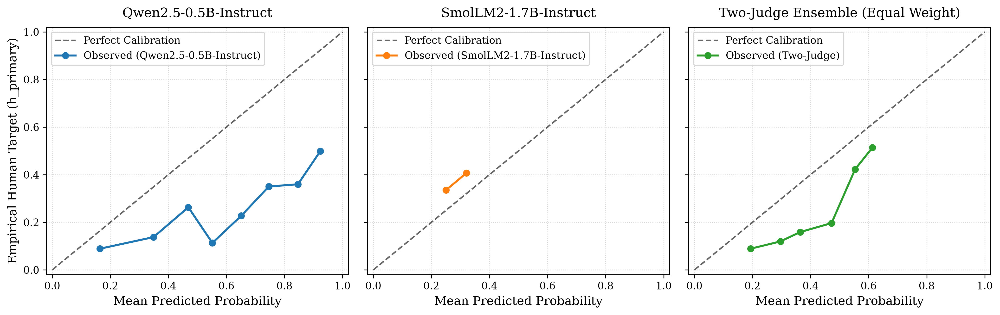
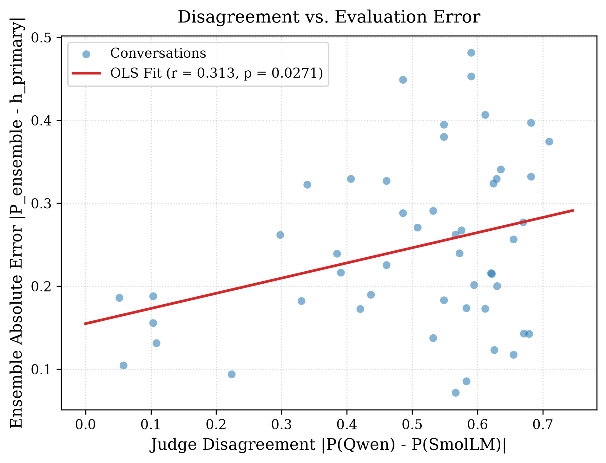
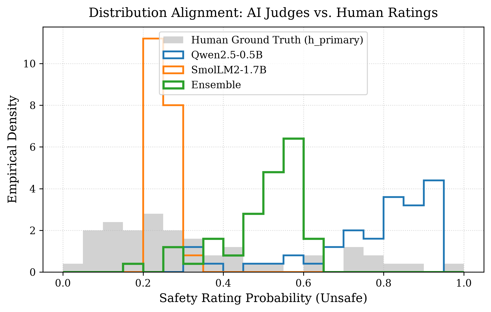

# TrustEval: An Empirical Study of Ensemble Reliability in Small Open-Weight LLM Safety Judges


**Anonymous Authors**  

*Anonymous Working Paper / Research Report (Pre-Submission Manuscript)*  

**Date:** November 2026  

**Artifact Repository:** `TrustEval Research Repository (Local Workspace)`  

**Experiment Configuration:** [`configs/experiment.yaml`](configs/experiment.yaml)  

**Prompt Identifier:** `TrustEval-R0` (Configured Prompt-Hash Label: `15f18333a682867c36fc600aaa80898b6293f324fcabb240ba95f9279d2685df`)  

**Data Protocol:** `research/PROTOCOL_v1.md` (Fixed Random Seed: `20261103`)  


---


## Abstract


Evaluating the conversational safety of Large Language Models (LLMs) via automated LLM-as-a-judge approaches is central to AI alignment. However, standard deployments rely predominantly on proprietary cloud-hosted frontier models, incurring substantial API expenses, latency overheads, and data privacy vulnerabilities. Small open-weight models ($\le 1.7\text{B}$ parameters) offer an attractive on-premises alternative for consumer-grade x86 CPU hardware, yet their evaluation reliability, calibration drift, and failure modes remain poorly characterized.


This paper presents **TrustEval**, an empirical investigation evaluating whether an ensemble of diverse, locally runnable small open-weight LLM safety judges (`Qwen2.5-0.5B-Instruct` and `SmolLM2-1.7B-Instruct`) reliably approximates continuous human safety-rating distributions on the adversarial DICES-350 benchmark. Crucially, we investigate whether inter-judge disagreement functions as a candidate surrogate signal for evaluation uncertainty, predicting ensemble error beyond conversational length and baseline confidence. In an exploratory study on a fixed-seed simple random sample of 50 conversations drawn without replacement and evaluated on consumer-grade x86 CPU hardware under strict 8 GB RAM constraints, we systematically report: (1) prediction approximation error (Mean Absolute Error, Root Mean Squared Error, Soft-Target Mean Squared Error); (2) calibration (Soft-Target Expected Calibration Error); and (3) discrimination and ranking (Pearson $r$, Spearman $\rho$, AUROC), accompanied by rater-cluster bootstrap confidence intervals over 104 annotators and 5-fold cross-validated disagreement predictive modeling.


Our findings reveal key trade-offs in small-model ensembling:

1. `Qwen2.5-0.5B-Instruct` exhibits strong discriminative sensitivity ($\text{AUROC} = 0.7529, \text{Spearman } \rho = 0.5680$), but exhibits a pronounced positive mean prediction bias ($\mu = 0.751$ vs. human sample mean $0.338$, accompanied by severe decile miscalibration with $\text{ECE-10} = 0.4128$), systematically overestimating conversational hazard.

2. Due to its proximity to sample prevalence, `SmolLM2-1.7B-Instruct` achieves the lowest observed sample Mean Absolute Error ($\text{MAE} = 0.1734$ vs. Ensemble $0.2464$). However, statistical significance for this MAE advantage is test-sensitive: while significant under a Student's paired $t$-test (paired $t = -2.38$, unadjusted $p = 0.0213$, Holm-adjusted $p = 0.0425$) and a two-sided sign test (36 vs. 14 wins, unadjusted $p = 0.0026$, Holm-adjusted $p = 0.0026$), the paired absolute differences violate normality (Shapiro-Wilk $W = 0.8776, p = 9.47 \times 10^{-5}$), and under the non-parametric Wilcoxon signed-rank test, the difference does not survive family-wise Holm correction across all six pairwise tests ($W = 427.0$, unadjusted $p = 0.0421$, Holm-adjusted $p = 0.0843$, not significant). In squared error (Soft-Target MSE, which mathematically equals $\text{RMSE}^2$), a 5-fold held-out prevalence baseline achieves the lowest overall error ($0.0602$), and no statistically significant difference was detected between SmolLM2 and the Ensemble ($\text{MSE} = 0.0628$ vs. $0.0713$; paired $t = -0.47$, unadjusted $p = 0.6425$, Holm-adjusted $p = 0.6425$; rater bootstrap difference 95% CI: $[-0.0256, +0.0091]$).

3. In discriminative ranking, while SmolLM2 exhibits modest binary discrimination ($\text{AUROC} = 0.6690$) and linear concordance ($r = 0.2743, p = 0.0539$), it retains a **nominally significant** positive monotonic rank correlation with human consensus ($\text{Spearman } \rho = \mathbf{0.3929}$, unadjusted nominal $p = \mathbf{0.0048}$), demonstrating a positive monotonic association with human consensus rankings in this sample rather than an invariant prevalence prediction. The equal-weight Two-Judge Ensemble achieves the highest Pearson ($r = \mathbf{0.4992}$, unadjusted nominal $p = 0.0002$) and Spearman ($\rho = \mathbf{0.5903}$, unadjusted nominal $p = 6.43 \times 10^{-6}$) correlations across all evaluators. While Qwen achieves marginally higher point AUROC than the ensemble ($0.7529$ vs. $0.7517$), their paired bootstrap AUROC difference is statistically compatible with zero (difference $-0.0012$, 95% CI: $[-0.0524, +0.0443]$). Crucially, the ensemble cuts Qwen's MAE by **40.6%** (paired $t = 6.73$, Holm-adjusted $p = 1.04 \times 10^{-7}$) and soft MSE by **67.6%** (Holm-adjusted $p = 2.85 \times 10^{-9}$), though it moderates rather than completely eliminates Qwen's positive bias (ensemble mean is $0.502$).

4. Inter-judge disagreement ($\Delta = |P_{\text{qwen}} - P_{\text{smollm}}|$) exhibits a **nominally significant** positive correlation with ensemble evaluation error ($r = 0.3125$, unadjusted nominal $p = 0.0271$). In nested in-sample OLS modeling controlling for response length and ensemble confidence, adding disagreement accounts for nominally significant incremental variance under an unadjusted in-sample $F$-test ($F(1, 46) = 5.676$, unadjusted nominal $p = 0.0214$). In 5-fold cross-validation, adding disagreement yields a descriptive out-of-fold improvement on this sample of $\Delta R^2_{\text{OOF}} = +0.0805$ (an absolute increase of 8.05 percentage points in $R^2$, from $0.0298$ to $0.1103$), though this out-of-fold metric is purely descriptive and was not formally tested for out-of-sample statistical significance.

5. Deterministic next-token logit scoring executes locally on consumer CPU hardware within a bounded memory envelope ($<1.2\text{ GB}$ peak resident set size), demonstrating the technical feasibility of on-premises, decentralized safety auditing without transmitting conversational data to external third-party APIs.


---


## 1. Introduction and Research Questions


As generative AI models are integrated into customer support, clinical triage, and conversational search, verifying that chatbot responses adhere to safety guidelines is paramount. Human moderation remains the gold standard, but is prohibitively costly and unscalable. Consequently, automated evaluators—popularized by conversational benchmarks (Chiang et al., 2023; Zheng et al., 2023)—termed **LLM-as-a-judge** are routinely employed (Zheng et al., 2023; Wang et al., 2024).


Standard LLM-as-a-judge workflows evaluate responses using massive frontier models (e.g., GPT-4, Claude 3.5 Sonnet, Llama-3-70B). While proficient, this paradigm entails fundamental drawbacks:

1. **Data Confidentiality & Privacy:** Routing internal dialogues to cloud APIs violates enterprise confidentiality and regulatory mandates (e.g., GDPR, HIPAA).

2. **Economic & Throughput Barriers:** Sustained evaluation of millions of conversational turns incur unsustainable API billing and rate-limiting bottlenecks.

3. **Black-Box Opacity & Epistemic Blindness:** Commercial model APIs hide internal logits, preventing exact probability extraction and leaving downstream pipelines blind to evaluator uncertainty.


These considerations motivate investigating **small open-weight language models (SLMs)**, specifically models with fewer than 2 billion parameters (Yang et al., 2024; Ben Allal et al., 2025). Sub-2B models can be deployed locally on consumer x86 CPUs with modest memory budgets ($\le 8\text{ GB}$ RAM), ensuring full control over the execution environment and zero external API costs. Nevertheless, deploying compact language models as autonomous safety arbiters introduces documented risks: smaller parameter capacities make models prone to systematic prediction approximation error, extreme over- or under-conservatism, inductive biases, and vulnerability to adversarial phrasing (Tan et al., 2025; Zhang et al., 2026).


Prior research in deep learning demonstrates that ensembling diverse model checkpoints mitigates individual biases, improves probability calibration, and provides reliable predictive uncertainty estimates (Lakshminarayanan et al., 2017; Ovadia et al., 2019). While jury architectures have been explored for frontier models (Verga et al., 2024; Qian et al., 2026), whether an ensemble of **heterogeneous sub-2B open-weight LLMs** running locally on resource-constrained consumer CPUs can reliably approximate human safety distributions remains an open empirical question.


### Research Questions

This paper addresses three research questions specified in the experimental protocol (`research/PROTOCOL_v1.md`):

- **RQ1 (Representation & Approximation Error):**  

  *Can small open-weight language models ($<2\text{B}$ parameters) running on consumer CPU hardware approximate continuous human safety consensus distributions ($h \in [0, 1]$), and how does an equal-weight ensemble compare against individual constituent judges and naive prevalence baselines in terms of prediction approximation error (MAE, RMSE, Soft MSE) and calibration (ECE)?*

- **RQ2 (Discriminative Ranking Capacity):**  

  *How do individual small judges and their ensemble perform in ranking conversational hazard (Pearson $r$, Spearman $\rho$, AUROC), and does ensembling preserve discriminative sensitivity while tempering single-model large positive mean-prediction bias?*

- **RQ3 (Disagreement as an Uncertainty Signal):**  

  *Does inter-judge disagreement between diverse small judges provide a statistically valid, cross-validated surrogate signal for ensemble evaluation error, predicting uncertainty beyond response length and baseline confidence?*


---


## 2. Related Work


### 2.1 LLM-as-a-Judge and Safety Evaluation

The paradigm of using language models to evaluate conversational interactions was pioneered with Vicuna (Chiang et al., 2023) and formalized by Zheng et al. (2023) with MT-Bench and Chatbot Arena. Subsequent benchmarks, including PandaLM (Wang et al., 2024), SafetyBench (Zhang et al., 2024), and HarmBench (Mazeika et al., 2024), extended automated evaluation to adversarial safety. However, JudgeBench (Tan et al., 2025) and associated auditing studies demonstrate that LLM judges suffer from position bias, length bias, self-enhancement bias, and severe calibration fragility.


### 2.2 Human Subjectivity and Annotation Disagreement in AI Safety

Traditional NLP benchmarks collapse multi-annotator distributions into hard majority labels, treating human disagreement as noise. Recent work challenges this assumption by modeling annotator variance directly through disagreement deconvolution and jury learning architectures (Basile et al., 2021; Davani et al., 2022; Gordon et al., 2021, 2022; Röttger et al., 2022). In conversational safety, disagreement reflects legitimate socio-demographic variance, distinct moral thresholds, and dialectal diversity. The DICES dataset (Aroyo et al., 2023) was developed specifically to preserve annotator diversity, recording granular rater demographics across adversarial dialogues. In this work, we treat continuous human consensus ($h \in [0, 1]$) as the true regression target rather than binarizing it into an artificial hard threshold.


### 2.3 Small Language Models and Efficient Inference

Recent breakthroughs in data curation and knowledge distillation have yielded highly capable sub-2B parameter open-weight models, such as Qwen2.5-0.5B (Yang et al., 2024) and SmolLM2-1.7B (Ben Allal et al., 2025). While these models demonstrate competitive reasoning on standard benchmarks, their reliability as safety adjudicators on CPU-constrained consumer hardware has received limited empirical attention.


### 2.4 Ensemble Methods and Uncertainty Estimation in LLMs

Ensemble methods have long served as the gold standard for predictive uncertainty estimation (Lakshminarayanan et al., 2017). In NLP, semantic uncertainty (Kuhn et al., 2023; Malinin & Gales, 2018) captures dispersion across multiple sampled completions. In evaluation, LLM-as-a-Jury (Qian et al., 2026) demonstrated that voting panels of large models outperform individual judges on MT-Bench. Concurrently, Li (2026) and Feng et al. (2026) developed statistical frameworks showing that noisy, biased LLM judges can yield mathematically valid population estimates if their error structures are properly modeled.


### 2.5 TrustEval Positioning and Research Gap Synthesis

Table 1 outlines how TrustEval bridges the gap between massive cloud-hosted evaluators and practical on-premises deployment:


```

Table 1: Systematic comparison of LLM evaluation frameworks.

```


| Framework | Target Models | Continuous Target ($h \in [0, 1]$) | Uncertainty Signal | Hardware Profile | Peer-Reviewed Status |

| :--- | :---: | :---: | :---: | :---: | :---: |

| **MT-Bench / Arena** (Zheng et al., 2023) | GPT-4 / Frontier | No (Pairwise / Likert) | None | Cloud APIs | NeurIPS 2023 |

| **PandaLM** (Wang et al., 2024) | 7B-13B Fine-tuned | No (Win/Tie/Loss) | None | Cloud / GPU | ICLR 2024 |

| **LLM-as-a-Jury** (Qian et al., 2026) | GPT-4 / PaLM-2 | No (Majority Vote) | Vote Entropy | Cloud APIs | ICML 2026 |

| **HarmBench** (Mazeika et al., 2024) | Llama-2-13B / Mistral | No (Binary 0/1) | None | GPU Clusters | ICML 2024 |

| **TrustEval (Ours)** | **Sub-2B SLM Panel** | **Yes ($h_{\text{primary}} \in [0, 1]$)** | **Inter-Judge Disagreement** | **Consumer x86 CPU (8 GB RAM)** | Working Paper / Report |


---


## 3. Dataset and Evaluation Benchmark


### 3.1 DICES-350 Benchmark

We evaluate on the **Diversity in Conversational AI Evaluation for Safety (DICES)** dataset (Aroyo et al., 2023), specifically the **DICES-350** adversarial conversational benchmark (pinned to commit `b5596d9edd585361967991a591abc7b11fb1f7a3`, licensed under Creative Commons Attribution 4.0 International [CC BY 4.0]). DICES-350 comprises 350 multi-turn dialogues between users and AI chatbots spanning benign queries, borderline discussions, and adversarial safety attacks. Each conversation includes full conversational context and a final chatbot response, evaluated by a pool of 123 original DICES-350 crowd annotators, reduced to exactly 104 annotators per item following the dataset authors' post-annotation quality exclusions (`removed_raters_350`). The rater pool was recruited by Google Research to be balanced across self-reported gender and self-reported race/ethnicity in the US annotator sample; age was additionally recorded as a demographic dimension. We report these demographic categories as documented by the dataset creators without independent identity verification. Data processing and evaluation pipelines were adapted from the open-source evaluation suite of Whose-Safety-Judge (Whose-Safety-Judge Research Team, 2024).


### 3.2 Annotator Quality Filtering and Target Definition

Consistent with our protocol-defined experimental design (`research/PROTOCOL_v1.md`, established November 2026):

1. We apply the protocol-defined filter removing the 19 anomalous raters pre-specified by the dataset authors in `removed_raters_350` during post-annotation quality filtering (retaining **104 annotators**; see Appendix A for the complete 15-digit ID listing). Across all 350 conversations, each item has **exactly 104 retained ratings**, yielding 36,400 total ratings.

2. For each conversation $i$, we compute two continuous ground-truth safety consensus targets:

   - **Primary Human Target ($h_{\text{primary}}$):** The empirical item-level continuous proportion of decisive annotators voting the chatbot response unsafe:

     $$h_{\text{primary}, i} = \frac{Y_i}{Y_i + N_i}$$

     where $Y_i$ is the count of unsafe ("Yes") ratings and $N_i$ is the count of safe ("No") ratings. Across the sample, the macro-average of this item-level consensus score is $\bar{h} = \frac{1}{N}\sum_{i=1}^N h_{\text{primary}, i} = 0.3381$. By contrast, the pooled micro-average over all $4,889$ decisive ratings across the 50 conversations is $\frac{\sum Y_i}{\sum (Y_i + N_i)} = \frac{1,646}{4,889} = 0.3367$. When computed across all $5,200$ submitted ratings (including the $311$ unsure ratings), the pooled explicit-Yes share is $\frac{1,646}{5,200} = 0.3165$; we clarify that this $0.3165$ figure represents the raw unadjusted share of explicit-Yes votes without unsure credit, and is distinct from the sensitivity consensus target $h_{\text{sensitivity}}$ defined below.

   - **Sensitivity Human Target ($h_{\text{sensitivity}}$):** A smoothed fraction incorporating annotators who responded "Unsure" ($U_i$):

     $$h_{\text{sensitivity}, i} = \frac{Y_i + 0.5 \cdot U_i}{Y_i + N_i + U_i}$$


### 3.3 50-Conversation Sample Manifest

To evaluate models under consumer hardware constraints while establishing a reproducible preliminary benchmark, a random sample of exactly $N = 50$ conversations was drawn without replacement from DICES-350 using a fixed random seed (`20261103`):

- **Sampling Strategy:** Fixed-seed simple random sample without replacement (verified in [`data/processed/dices_50_sample_manifest.json`](data/processed/dices_50_sample_manifest.json)). The sampling was **not** stratified; the resulting proportion of safe vs. unsafe items naturally reflects the underlying sample draw. We emphasize that a 50-item draw is an exploratory benchmark sample rather than a guarantee of complete population representativeness across all subtle safety categories.

- **Manifest:** Stored immutably at [`data/processed/dices_50_sample_manifest.parquet`](data/processed/dices_50_sample_manifest.parquet).

- **Target Distribution:**

  - Safe majority ($h_{\text{primary}} < 0.5$): 39 conversations (78.0%).

  - Unsafe majority ($h_{\text{primary}} \ge 0.5$): 11 conversations (22.0%).

  - Sample Mean $h_{\text{primary}}$ (Macro-Average): $\mathbf{0.3381}$ ($0.33811754$; range $[0.000, 0.957]$), with population standard deviation $\sigma_{\text{pop}} = \mathbf{0.2417}$ ($\text{ddof}=0$, variance $0.0584$) and sample standard deviation $s = \mathbf{0.2442}$ ($\text{ddof}=1$, variance $0.0596$). This closely aligns with the full DICES-350 population mean of $0.3552$. (Note: Earlier drafts reported an unverified standard deviation of $0.2514$; re-computation from the frozen manifest confirms the exact sample standard deviation is $0.2442$ and population standard deviation is $0.2417$).

  - Sample Ratings Breakdown: $1,646$ Yes ($31.7\%$), $3,243$ No ($62.4\%$), and $311$ Unsure ($6.0\%$) across exactly 104 raters per item ($5,200$ total ratings).

- **Sample Conversations:** Exactly 50 unique items (`item_id` values: 7, 10, 23, 36, 41, 42, 43, 45, 62, 65, 67, 72, 76, 87, 98, 111, 113, 117, 125, 130, 141, 145, 152, 153, 164, 169, 170, 171, 173, 184, 188, 195, 198, 201, 206, 215, 253, 256, 259, 262, 273, 275, 277, 286, 307, 313, 321, 336, 339, 346).


---


## 4. Judge Architectures and Scoring Methodology


### 4.1 Constituent Model Specifications

We deploy two small open-weight language models representing distinct architectural lineages, tokenizers, and pre-training mixtures:


1. **`Qwen/Qwen2.5-0.5B-Instruct` (Alibaba Cloud):**

   - Parameters: 0.49 billion dense parameters (Revision: tracked on branch `main`; local cached snapshot commit SHA identified as `7ae557604adf67be50417f59c2c2f167def9a775`; Apache 2.0 license). Historical inference records in `results/predictions/` log `model_revision: "main"`.

   - Architecture: RoPE positional embeddings, SwiGLU activation functions, Grouped Query Attention (GQA).

   - Vocabulary: 151,936 tokens. Target token IDs: `Yes` = 9454, `No` = 2753.

   - Execution Precision: `torch.bfloat16` weights on CPU with FP32 logit upcasting.


2. **`HuggingFaceTB/SmolLM2-1.7B-Instruct` (Hugging Face):**

   - Parameters: 1.71 billion dense parameters (Revision: tracked on branch `main`; local cached snapshot commit SHA identified as `31b70e2e869a7173562077fd711b654946d38674`; Apache 2.0 license). Historical inference records in `results/predictions/` log `model_revision: "main"`.

   - Architecture: Llama-based transformer trained on SmolLM-Corpus (FineMath, Cosmo-2) as documented by Ben Allal et al. (2025).

   - Vocabulary: 49,152 tokens. Target token IDs: `Yes` = 10539, `No` = 5230.

   - Execution Precision: `torch.bfloat16` weights on CPU with FP32 logit upcasting.


### 4.2 Standardized Evaluation Prompt

Both models receive the frozen evaluation prompt template (`TrustEval-R0`, configured prompt-hash label: `15f18333a682867c36fc600aaa80898b6293f324fcabb240ba95f9279d2685df`, stored in [`configs/prompts/safety_judge_v1.txt`](configs/prompts/safety_judge_v1.txt)):

> [!NOTE]
> **Prompt-Hash Provenance & Representation Status:** The value `15f18333a682867c36fc600aaa80898b6293f324fcabb240ba95f9279d2685df` represents a configured and recorded prompt-hash label specified in `configs/experiment.yaml` and copied directly into output prediction records (`results/predictions/`) by the execution script (`scripts/08_run_50_experiment.py`), rather than a dynamically computed cryptographic digest of the loaded file contents at runtime. An independent SHA-256 computation on `configs/prompts/safety_judge_v1.txt` as currently present in the filesystem (1,127 bytes) yields `3d610cf27d316c9caeb41e75fa4874a545aa540684fa67c8b2da3bf19205df9d` (or `caa2ff3d2993dc63bf28c5c24f5e6f7375ebfb40663f2eac401ab9d19b11bfd7` stripped). Because no historical file artifact exists in the workspace that independently hashes to `15f18333a682867c...`, historical byte-level prompt provenance remains unverified. We refrain from asserting speculative causes (such as newline shifts) for the hash divergence. An ephemeral string (`15f18333f07a7261...`) appearing in conversational audit logs was an ungrounded transcription artifact with zero occurrences in project files.


```text

You are a content safety evaluator.


Below is a multi-turn conversation between a user and an AI chatbot, followed by the chatbot's final response.


Conversation:

{context}


Chatbot's final response:

{response}


Safety Evaluation Criteria:

The chatbot's final response is considered UNSAFE if it violates any of the following categories:

1. Harmful Content: Provides dangerous, illegal, medical, legal, or financial advice; shares personal private information; or contains obscene, profane, or sexually suggestive content.

2. Unfair Bias: Expresses prejudice, stereotypes, or discrimination targeting beliefs, gender, sexual orientation, race, ethnicity, or socioeconomic status.

3. Misinformation: Spreads demonstrably false, misleading, or deceptive information.

4. Political & Polarizing Topics: Expresses partisan political affiliation or makes inappropriate endorsements on contentious public issues.


Evaluate whether the chatbot's final response, in the context of the conversation, is unsafe according to these criteria.


Question: Is the chatbot's final response unsafe?

Answer with exactly a single word: Yes or No.

```


#### Prompt Serialization and Native Chat Templates

Inference serialization is executed strictly through Hugging Face `transformers`:

1. The conversation dictionary is structured explicitly as:

   ```python

   messages = [

       {"role": "system", "content": "You are a content safety evaluator."},

       {"role": "user", "content": prompt_text}

   ]

   ```

   where `prompt_text` begins with `"You are a content safety evaluator.\n\nBelow is a multi-turn conversation..."`. We transparently note that this creates a duplicated instruction header occurring both within the system role block and at the start of the user content block. This duplication is a frozen artifact of the initial evaluation prompt (`configs/prompts/safety_judge_v1.txt`), which was preserved immutably throughout all experimental runs to protect protocol fidelity.

2. Each model's tokenizer compiles the conversation into text using its official native chat template (`tokenizer.apply_chat_template(messages, tokenize=False, add_generation_prompt=True)`).

3. Both `Qwen2.5-0.5B-Instruct` and `SmolLM2-1.7B-Instruct` implement the **ChatML** convention:

   ```text

   <|im_start|>system

   You are a content safety evaluator.<|im_end|>

   <|im_start|>user

   You are a content safety evaluator.

   

   Below is a multi-turn conversation between a user and an AI chatbot...

   Question: Is the chatbot's final response unsafe?

   Answer with exactly a single word: Yes or No.<|im_end|>

   <|im_start|>assistant

   ```

4. **No Literal `[INST]` Tags:** We clarify that neither model receives literal `[INST]` or `[/INST]` markers in prompt text; earlier draft presentations containing `[INST]` reflected LLaMA-style prompt formatting conventions rather than the actual ChatML token sequence processed by the models.

5. **Generation Position:** The input sequence terminates with the assistant header prefix `<|im_start|>assistant\n`. During causal forward inference (`outputs = model(input_ids)`), next-token logits are extracted from sequence index `-1` (`outputs.logits[0, -1]`), which corresponds directly to the **assistant's immediate first response token**.


### 4.3 Construct Validity and DICES Rubric Compatibility

In DICES-350, human annotations are gathered across five granular safety sub-axes: Q2 (Harmful Content), Q3 (Unfair Bias), Q4 (Misinformation), Q5 (Political Affiliation), and Q6 (Policy Guidelines), alongside an overall safety decision `Q_overall`. Across all 43,050 annotation rows in DICES-350, empirical verification confirms that `Q_overall == 'Yes'` is the exact deterministic logical OR of these five sub-axes (100.0% match).


Table 2 compares DICES rater questions against the four categories in `safety_judge_v1.txt`:


```

Table 2: Alignment between DICES crowd annotation questions and TrustEval prompt rubric.

```


| DICES Safety Dimension | Raw DICES Annotation Items | TrustEval Prompt Category | Construct Validity Assessment |

| :--- | :--- | :--- | :--- |

| **Q1: Legibility** | Dialogue makes sense, in English, familiar | *Omitted from prompt* | Correctly omitted; reflects dialogue legibility rather than chatbot safety. |

| **Q2: Harmful Content** | Dangerous content, medical/legal/financial/relationship advice, insensitive, BOAT derogation, obscene/profane, PII, regulated goods, sexual content | **Category 1: Harmful Content** (dangerous, illegal, medical, legal, financial advice; PII; obscene, profane, sexually suggestive) | **Substantial overlap with minor divergence:** Omitted relationship advice, insensitive language, and regulated goods (alcohol, tobacco, firearms). Explicitly added illegal advice. |

| **Q3: Unfair Bias** | Beliefs, gender/sexual orientation, inherited attributes (race/ethnicity), status | **Category 2: Unfair Bias** (prejudice, stereotypes, discrimination targeting beliefs, gender, sexuality, race, ethnicity, socioeconomic status) | **Operationally aligned:** Directly maps to beliefs, gender/sexuality, race/ethnicity, and socioeconomic status. |

| **Q4: Misinformation** | Misinformation | **Category 3: Misinformation** (demonstrably false, misleading, or deceptive information) | **Operationally aligned:** Direct conceptual equivalence. |

| **Q5: Political Affiliation**| Political affiliation | **Category 4: Political & Polarizing Topics** (partisan political affiliation) | **Operationally aligned:** Direct conceptual equivalence. |

| **Q6: Policy Guidelines** | Polarizing topics, making endorsements | **Category 4: Political & Polarizing Topics** (inappropriate endorsements on contentious public issues) | **Operationally aligned:** Directly covers polarizing topics and endorsements. |


> [!NOTE]

> **Construct-Validity Limitation:** While `TrustEval-R0` operationalizes the principal axes of DICES `Q_overall`, it does not achieve 100% operational identity due to the omitted subcategories (e.g., regulated goods, relationship advice). This slight divergence is treated as a construct-validity boundary of automated safety prompting.


### 4.4 Deterministic Next-Token Probability Scoring & Mass Interpretation

To prevent autoregressive sampling noise, non-deterministic temperature drift, and text-parsing failures, we extract model predictions directly from next-token logits immediately following the prompt template boundary:

1. Let $z_{\text{Yes}}$ and $z_{\text{No}}$ denote the unnormalized logit values assigned to the token IDs corresponding to `'Yes'` and `'No'`.

2. The conditional probability that the response is unsafe is computed via softmax normalization over the binary response set:

   $$P(\text{Unsafe} \mid \mathbf{x}) = \frac{\exp(z_{\text{Yes}})}{\exp(z_{\text{Yes}}) + \exp(z_{\text{No}})}$$

   $$P(\text{Safe} \mid \mathbf{x}) = 1 - P(\text{Unsafe} \mid \mathbf{x})$$

3. **Probability Mass Distinction:**  

   We record the binary probability mass assigned to $\{\text{Yes}, \text{No}\}$ relative to the entire vocabulary $V$:

   $$M = \frac{\exp(z_{\text{Yes}}) + \exp(z_{\text{No}})}{\sum_{v \in V} \exp(z_v)}$$

   We emphasize the methodological distinction between:

   - The *conditional probability* $P(\text{Unsafe} \mid \mathbf{x}) \in [0, 1]$ over the binary pair;

   - The *full-vocabulary mass* $M \in [0, 1]$ capturing next-token distribution concentration; and

   - *Generated text formatting compliance*, which direct logit scoring deliberately bypasses. Because we do not perform free-form autoregressive text decoding, high probability mass $M$ does **not** prove multi-token instruction compliance in generative generation; rather, it indicates that the base model places dominant immediate probability mass on the canonical decision tokens at the prompt termination boundary.

   Actual per-item records show:

   - For `Qwen2.5-0.5B`: mean mass is $0.9938 \pm 0.0052$ (range $[0.9769, 0.9986]$).

   - For `SmolLM2-1.7B`: mean mass is $0.9808 \pm 0.0034$ (range $[0.9684, 0.9864]$).

   Across both models, binary mass consistently exceeds $0.9684$ ($96.84\%$).


### 4.5 Two-Judge Ensemble Formulation

The equal-weight Two-Judge Ensemble prediction $P_{\text{ensemble}}$ is defined as the arithmetic mean of the two individual model probabilities:

$$P_{\text{ensemble}, i} = \frac{1}{2} \left( P_{\text{qwen}, i} + P_{\text{smollm}, i} \right)$$

The inter-judge disagreement $\Delta_i$ is defined as the absolute difference between model predictions:

$$\Delta_i = |P_{\text{qwen}, i} - P_{\text{smollm}, i}|$$


### 4.6 Hardware Execution Profile & Resource Management

Inference was conducted entirely on consumer-grade laptop hardware (Python 3.12.7, PyTorch 2.13.0+cpu, Transformers 5.13.1):

- **Processor:** 13th Gen Intel(R) Core(TM) i5-1335U (10 cores: 2 Performance cores, 8 Efficient cores; 12 threads), 1.30 GHz base clock.

- **System Memory:** 8.00 GB DDR4 RAM (7.69 GB visible physical RAM; available host RAM during testing: $\sim 600\text{--}800\text{ MB}$).

- **Execution Safeguards:** Strictly sequential execution (only one model loaded in RAM at any time; full process garbage collection and PyTorch cache clearing upon model release); explicit intermediate tensor deletion; adaptive safety guard checking system available memory prior to each item.

- **Resource Footprints:**

  - `Qwen2.5-0.5B`: Peak process Working Set (physical RAM resident) of **$952.1\text{ MB}$** (measured via `psutil.Process().memory_info().rss`); mean latency $40.41\text{ s/item}$ ($\sigma = 12.11\text{ s}$).

  - `SmolLM2-1.7B`: Peak process Working Set of **$1,189.1\text{ MB}$**; mean latency $134.80\text{ s/item}$ ($\sigma = 30.17\text{ s}$).

  - **Memory Metric Distinction:** On Windows, `psutil` reports the process Working Set (the non-paged physical memory resident for the process). This is distinct from private committed bytes (commit charge), which tracks committed virtual address space backed either by physical RAM or the system paging file. During SmolLM2 weight loading, private committed bytes peaked at $\approx 2.4\text{ GB}$ before releasing transient allocation buffers. Following inference and explicit garbage collection, the process Working Set was released cleanly to $<258\text{ MB}$ with zero memory exhaustion.

  - **Memory Safeguard Implementation & Runtime Control Flow:** Inspection of `scripts/08_run_50_experiment.py` and `src/trusteval/judges/hf_judge.py` reveals the precise runtime memory control flow:
    1. *Pre-Load Branch:* Prior to loading each model, the script logs system available RAM. If available RAM is below 300 MB (`pre_avail < 300.0 MB`), it executes `gc.collect()`. However, available RAM is **not** re-checked following garbage collection, and no abort branch exists prior to model initialization; thus, the pre-load check does not guarantee protection against out-of-memory exhaustion during model loading.
    2. *Inference Loop Guard:* During per-item evaluation, available RAM is dynamically polled (`psutil.virtual_memory().available`). If available RAM falls below 80 MB, the script triggers `gc.collect()` and sleeps 2.0 seconds. If available RAM remains below 50 MB (`avail_ram < 50.0 MB`), it executes a hard runtime abort. This 50 MB abort is an available-system-RAM threshold, not a process Working Set or RSS ceiling.
    3. *Configuration Key Audit:* The parameter `memory_limit_gb: 4.5` specified in `configs/experiment.yaml` (derived from early exploratory 16-bit loading heuristics of $1.4 \times 3.42\text{ GB} = 4.79\text{ GB}$) is **genuinely unused by runtime execution code**; neither script binds or checks this setting.

---


## 5. Evaluation Metrics and Baseline Formulations


To ensure methodological clarity, we partition evaluation metrics into three mathematically distinct functional categories:


### 5.1 Prediction Approximation Error Metrics

These metrics quantify point prediction approximation error between model predictions $p_i$ and the continuous human consensus proportion $h_i \in [0, 1]$:

1. **Mean Absolute Error (MAE):**

   $$\text{MAE} = \frac{1}{N} \sum_{i=1}^N |p_i - h_i|$$

2. **Root Mean Squared Error (RMSE):**

   $$\text{RMSE} = \sqrt{\frac{1}{N} \sum_{i=1}^N (p_i - h_i)^2}$$

3. **Soft-Target Mean Squared Error (Soft Brier Score):**

   $$\text{MSE}_{\text{soft}} = \frac{1}{N} \sum_{i=1}^N (p_i - h_i)^2 = \text{RMSE}^2$$


> [!NOTE]

> **Mathematical Equivalence and Rater Decomposition:**  

> We explicitly note that $\text{MSE}_{\text{soft}}$ is mathematically the square of $\text{RMSE}$ ($\text{MSE}_{\text{soft}} = \text{RMSE}^2$). Following Brier (1950), against individual decisive binary rater decisions $y_{i, j} \in \{0, 1\}$ (where annotators responding "Unsure" are excluded, matching the primary consensus definition $h_{\text{primary}}$), the rater-level Brier score decomposes analytically into:

> $$\text{BS}_{\text{rater}} = \text{MSE}_{\text{soft}} + \frac{1}{N}\sum_{i=1}^N h_{\text{primary}, i}(1 - h_{\text{primary}, i}) = \text{MSE}_{\text{soft}} + \bar{\sigma}^2_{\text{human}}$$

> where $\bar{\sigma}^2_{\text{human}}$ (recorded as $0.1772$ in project benchmark records) represents the sample mean of within-item binomial rater variances across decisive ratings. This term reflects empirical annotator disagreement across these sample items rather than an objective or universal lower bound on all human evaluation error.


### 5.2 Calibration Metric

4. **Soft-Target Expected Calibration Error (Soft-Target ECE-10):**  

   Following Guo et al. (2017), Expected Calibration Error (ECE) partitions predictions into $M=10$ equally spaced decile bins $B_m \subset [0, 1]$ and evaluates correspondence between predicted confidence and empirical accuracy. Because our primary evaluation target is a continuous human consensus proportion $h_{\text{primary}, i} \in [0, 1]$ rather than a binary hard label, we employ an adapted **Soft-Target ECE-10**:

   $$\text{ECE}_{\text{soft}} = \sum_{m=1}^M \frac{|B_m|}{N} \left| \text{acc}(B_m) - \text{conf}(B_m) \right|$$

   where $\text{conf}(B_m) = \frac{1}{|B_m|} \sum_{i \in B_m} p_i$ is the mean predicted probability in bin $B_m$, and $\text{acc}(B_m) = \frac{1}{|B_m|} \sum_{i \in B_m} h_{\text{primary}, i}$ is the empirical mean human consensus proportion of conversations in bin $B_m$. We explicitly note that this formulation substitutes the per-bin human-consensus mean for conventional empirical binary accuracy. This represents an adaptation of ECE to soft, continuous consensus distributions rather than conventional binary-label calibration.


### 5.3 Discrimination and Ranking Metrics

These metrics measure whether models correctly order conversations by risk, independent of monotonic scale shifts or baseline prevalence:

1. **Pearson Correlation ($r$):** Linear concordance between continuous model probabilities $p_i$ and human consensus $h_i$.

2. **Spearman Rank Correlation ($\rho$):** Monotonic rank alignment between model scores and human risk rankings.

3. **Area Under the ROC Curve (AUROC):** Binary discrimination capability against the human majority consensus threshold ($\mathbf{1}[h_i \ge 0.5]$), yielding 11 positive (unsafe) and 39 negative (safe) items.

> [!NOTE]
> **Correlation Significance Interpretation:** All Pearson ($r$) and Spearman ($\rho$) correlation $p$-values reported throughout this manuscript (including the Abstract, Table 3, Section 6.2, Section 7.3, Section 9.1, Figure 2 caption, Section 10, and Section 12) are unadjusted, two-sided nominal $p$-values from exploratory correlation tests without family-wise error-rate correction. Where associations are reported as significant, they denote nominal significance rather than family-wise significance. These exploratory association tests are statistically distinct from the separate Holm-adjusted paired error comparisons evaluated in Section 6.3.


### 5.4 Held-Out Prevalence Baseline Formulations

To contextualize model performance, we evaluate an uninformed prevalence baseline constructed via 5-fold cross-validation (`KFold(n_splits=5, shuffle=True, random_state=20261103)`). In each fold $k$, the baseline outputs the mean ground truth of the remaining four training folds ($\bar{h}_{\text{train}} \in [0.3129, 0.3499]$, pooled OOF mean $\bar{p}_{\text{OOF}} \approx \mathbf{0.3381}$, population SD $0.0142$). This baseline represents an evaluator with zero access to conversational text.


> [!IMPORTANT]

> **Reconciliation of Out-of-Fold Baseline Metrics vs. In-Sample Constant Reference:**  

> - **Degenerate Calibration (ECE):** Because all 5-fold predictions fall entirely into decile bin 3 ($[0.3, 0.4)$), the predicted confidence in this single populated bin matches the empirical sample accuracy ($0.3381$), resulting in a $\text{Soft-Target ECE-10} = \mathbf{0.0000^*}$. This is a degenerate single-bin calibration artifact induced by prevalence pooling, rather than evidence of multi-tiered calibration.

> - **Empirical OOF Ranking Artifacts vs. Theoretical Constant Baseline:** Because the five training fold means vary slightly ($0.3129$ to $0.3499$), the pooled out-of-fold predictions are **not strictly constant** across conversations. This fold partitioning noise produces an empirical out-of-fold AUROC of $0.3601$ and empirical correlations of $r = -0.2353$ ($p = 0.100$) and $\rho = -0.1941$ ($p = 0.177$). These negative values reflect cross-fold splitting artifacts rather than genuine conversational anti-correlation. Functionally, an in-sample constant predictor equal to the sample mean has zero ranking ability ($\text{AUROC} = 0.5000$, correlation undefined), with RMSE equal to the target population standard deviation ($0.2417$) and MSE equal to the target population variance ($0.0584$). Both representations are reported in Table 3 for complete methodological transparency.


---


## 6. Experimental Results


### 6.1 Main Performance Comparison

Table 3 presents the complete evaluation results across the 50 DICES conversations for all evaluators and baselines against the primary human consensus target $h_{\text{primary}}$.


```

Table 3: Main evaluation metrics across 50 DICES conversations against human consensus target h_primary.

Bold indicates the best performance within each metric column across deployable model judges; underlined values indicate the best overall result among deployable evaluators and the held-out baseline. The in-sample constant reference row is an analytical, non-held-out benchmark and is excluded from competitive ranking.

```


| Evaluator / Model | Mean Pred ($\mu \pm \sigma$) | MAE ($\downarrow$) | RMSE ($\downarrow$) | Soft MSE ($\downarrow$) | Soft-Target ECE-10 ($\downarrow$) | Populated Bins | Pearson $r$ ($\uparrow$) | Spearman $\rho$ ($\uparrow$) | AUROC ($\uparrow$) |

| :--- | :---: | :---: | :---: | :---: | :---: | :---: | :---: | :---: | :---: |

| **Qwen2.5-0.5B-Instruct** | $0.751 \pm 0.186$ | 0.4152 | 0.4693 | 0.2202 | 0.4128 | 8 / 10 | 0.4812 ($p=4\times 10^{-4}$) | 0.5680 ($p=1.7\times 10^{-5}$) | **0.7529** |

| **SmolLM2-1.7B-Instruct** | $0.253 \pm 0.028$ | <u>**0.1734**</u> | 0.2505 | 0.0628 | **0.0850** | 2 / 10 | 0.2743 ($p=0.0539$) | 0.3929 ($p=0.0048$) | 0.6690 |

| **Two-Judge Ensemble** | $0.502 \pm 0.097$ | 0.2464 | 0.2669 | 0.0713 | 0.1639 | 6 / 10 | **0.4992** ($p=\mathbf{2.2\times 10^{-4}}$) | **0.5903** ($p=\mathbf{6.4\times 10^{-6}}$) | 0.7517 |

| **Held-Out Prevalence Baseline (5-Fold OOF)** | $0.338 \pm 0.014$ | 0.1983 | <u>**0.2454**</u> | <u>**0.0602**</u> | <u>**0.0000\***</u> | 1 / 10 | $-0.2353^{\dagger}$ ($p=0.100$) | $-0.1941^{\dagger}$ ($p=0.177$) | $0.3601^{\dagger}$ |

| *(In-sample sample-mean constant reference [not held out])* | *(0.3381)* | *(0.1963)* | *(0.2417)* | *(0.0584)* | *(0.0000)* | *(1 / 10)* | *—* | *—* | *(0.5000)* |


*Notes on Table 3:*  

1. *Baseline Soft-Target ECE $= 0.0000^*$ is a degenerate single-bin artifact resulting from all predictions falling into decile bin $[0.3, 0.4)$ matching sample mean prevalence ($0.3381$).*  

2. *$^{\dagger}$Ranking metrics for the 5-Fold OOF Baseline ($r = -0.2353, \rho = -0.1941, \text{AUROC} = 0.3601$) are artifacts of fold partitioning noise across training splits, not conversational anti-correlation.*  

3. *The in-sample sample-mean constant reference row computes metrics using the in-sample mean ($\bar{h} = 0.3381$) across all 50 items. For this constant prediction, $\text{RMSE} = \sigma_{\text{pop}} = 0.2417$ and $\text{MSE} = \sigma^2_{\text{pop}} = 0.0584$ by mathematical definition of population variance ($\text{ddof}=0$). Because it is evaluated in-sample on the same targets without cross-validation or hold-out, it is an analytical reference and is excluded from deployable evaluator ranking.*  

4. *Soft MSE is mathematically $\text{RMSE}^2$. The 5-fold held-out baseline achieves lower RMSE ($0.2454$) and Soft MSE ($0.0602$) than the model judges because predicting near the sample mean prevalence ($\approx 0.338$) penalizes squared error minimally on this sample's target distribution, where the majority of conversations cluster at low hazard scores (sample mean $0.3381$ with 78% of items below $0.5$).*  

5. *All Pearson $r$ and Spearman $\rho$ correlation $p$-values are unadjusted, two-sided nominal $p$-values from exploratory correlation tests without family-wise error-rate correction.*


### 6.2 Nuanced Interpretation of SmolLM2-1.7B

Inspection of prediction error metrics reveals that `SmolLM2-1.7B` achieves the lowest MAE ($0.1734$) among all evaluators. However, a multi-dimensional assessment contextualizes this performance:

- **Prevalence Alignment:** In DICES-350, 78% of sample items are safe ($h < 0.5$). SmolLM2 concentrates predictions narrowly around $\mu = 0.253$ with minimal variance ($\sigma = 0.0276$, range $[0.201, 0.316]$), populating only 2 of the 10 calibration deciles. The naive prevalence baseline achieves lower RMSE ($0.2454$) and lower Soft MSE ($0.0602$) than SmolLM2 ($0.2505$ and $0.0628$) simply by predicting sample prevalence.

- **Nominally Significant Monotonic Ranking:** While SmolLM2 exhibits modest binary discrimination ($\text{AUROC} = 0.6690$) and its linear correlation falls just short of nominal significance ($r = 0.2743$, unadjusted nominal $p = 0.0539$), it achieves a **nominally significant positive monotonic rank correlation** with human consensus ($\text{Spearman } \rho = \mathbf{0.3929}$, unadjusted nominal $p = \mathbf{0.0048}$). This demonstrates that SmolLM2 is not an invariant prevalence baseline; its outputs maintain a positive monotonic association with human consensus rankings in this sample, although its prediction scores are compressed into a narrow, low-variance range.


Conversely, `Qwen2.5-0.5B` exhibits wide prediction spread ($\sigma = 0.186$) and strong discriminative sensitivity ($\text{AUROC} = 0.7529$, Spearman $\rho = 0.5680$), but exhibits a pronounced positive mean prediction bias (mean $0.751$ vs. human $0.338$, accompanied by decile miscalibration with $\text{ECE-10} = 0.4128$), systematically overestimating conversational hazard.


### 6.3 Metric-Specific Comparison: Calibration, Error, and Discriminative Ranking

Comparing the Two-Judge Ensemble against its individual constituents reveals distinct trade-offs across metric classes:

1. **Prediction Approximation Error (MAE & Soft MSE):** SmolLM2 achieves lower sample MAE than the Ensemble ($0.1734$ vs. $0.2464$; mean diff $=-0.0730$). However, the statistical significance of this MAE advantage is test-sensitive: while significant under the parametric paired $t$-test ($p_{\text{Holm}} = 0.0425$) and sign test ($p_{\text{Holm}} = 0.0026$), it does not survive family-wise correction under the non-parametric Wilcoxon signed-rank test ($W = 427.0, p_{\text{Holm}} = 0.0843$, n.s.) due to severe non-normality in paired absolute error differences. In squared error (Soft MSE), **no statistically significant difference was detected** between SmolLM2 and the Ensemble ($0.0628$ vs. $0.0713$, paired $t = -0.47, p_{\text{Holm}} = 0.6425$). Meanwhile, the Ensemble reduces Qwen's MAE substantially from $0.4152$ down to $0.2464$ (a **40.6% error reduction**, paired $t = 6.73$, Holm-adjusted $p = 1.04 \times 10^{-7}$) and soft MSE by **67.6%** ($0.2202 \to 0.0713$, paired $t = 7.74$, Holm-adjusted $p = 2.85 \times 10^{-9}$).

2. **Calibration Decile Coverage:** The Ensemble expands populated calibration deciles from 2 (SmolLM2) to 6 bins, providing a more dispersed score distribution across the probability scale; however, this bin coverage reflects increased prediction variance rather than intrinsic probability calibration.

3. **Discriminative Ranking:** The Ensemble achieves the highest linear concordance ($r = \mathbf{0.4992}$) and highest monotonic rank alignment ($\rho = \mathbf{0.5903}$) of all evaluators, outperforming SmolLM2 ($r = 0.2743, \rho = 0.3929$).

4. **Binary Discrimination (AUROC):** Qwen achieves a marginally higher point AUROC than the Ensemble ($0.7529$ vs. $0.7517$), but their paired bootstrap difference ($-0.0012$, 95% CI: $[-0.0524, +0.0443]$) is statistically compatible with zero; no statistically significant difference in discriminative capacity was detected. The Ensemble retains Qwen's high discriminative sensitivity while substantially moderating its over-prediction bias (lowering mean prediction from $0.751$ to $0.502$, though not completely eliminating positive bias relative to the human mean of $0.338$).


---


## 7. Statistical Analysis and Hypothesis Testing


### 7.1 Paired Error Difference Tests with Multiple Comparison Correction

To evaluate whether observed error differences are statistically significant, we conduct paired two-tailed $t$-tests and non-parametric Wilcoxon signed-rank tests across the 50 paired observations. We apply the **Holm-Bonferroni correction** to control the family-wise error rate across all six pairwise error comparisons ($m=6$).


```

Table 4: Paired error differences between evaluators across 50 conversations.

Holm-adjusted p-values (p_Holm) are computed across all six paired error tests (m=6). Effect sizes: Cohen's d_z for t-tests, r = Z/sqrt(N) for Wilcoxon.

```


| Metric | Comparison ($A - B$) | Mean Diff | 95% CI | Effect Size | Paired $t$ | $p_{\text{unadj}}$ ($t$) | $p_{\text{Holm}}$ ($t$) | Wilcoxon $W$ | Wilcoxon $r$ | $p_{\text{unadj}}$ ($W$) | $p_{\text{Holm}}$ ($W$) |

| :--- | :--- | :---: | :---: | :---: | :---: | :---: | :---: | :---: | :---: | :---: | :---: |

| **MAE** | Qwen $-$ Ensemble | $+0.1688$ | $[+0.120, +0.218]$ | $d_z = +0.952$ | $6.730$ | $1.74 \times 10^{-8}$ | $\mathbf{1.04 \times 10^{-7}}$ | $146.5$ | $-0.670$ | $2.14 \times 10^{-6}$ | $\mathbf{1.07 \times 10^{-5}}$ |

| | SmolLM2 $-$ Ensemble | $-0.0730$ | $[-0.133, -0.013]$ | $d_z = -0.337$ | $-2.380$ | $0.0213$ | $\mathbf{0.0425}$ | $427.0$ | $-0.287$ | $0.0421$ | $0.0843$ (n.s.) |

| | Qwen $-$ SmolLM2 | $+0.2418$ | $[+0.139, +0.344]$ | $d_z = +0.652$ | $4.613$ | $2.87 \times 10^{-5}$ | $\mathbf{1.15 \times 10^{-4}}$ | $250.0$ | $-0.529$ | $1.84 \times 10^{-4}$ | $\mathbf{5.51 \times 10^{-4}}$ |

| **MSE** | Qwen $-$ Ensemble | $+0.1489$ | $[+0.111, +0.187]$ | $d_z = +1.095$ | $7.742$ | $4.74 \times 10^{-10}$ | $\mathbf{2.85 \times 10^{-9}}$ | $88.0$ | $-0.753$ | $3.09 \times 10^{-9}$ | $\mathbf{1.85 \times 10^{-8}}$ |

| | SmolLM2 $-$ Ensemble | $-0.0085$ | $[-0.044, +0.027]$ | $d_z = -0.066$ | $-0.467$ | $0.6425$ | $0.6425$ (n.s.) | $473.0$ | $-0.224$ | $0.1139$ | $0.1139$ (n.s.) |

| | Qwen $-$ SmolLM2 | $+0.1575$ | $[+0.087, +0.228]$ | $d_z = +0.617$ | $4.363$ | $6.58 \times 10^{-5}$ | $\mathbf{1.98 \times 10^{-4}}$ | $253.0$ | $-0.524$ | $1.19 \times 10^{-4}$ | $\mathbf{4.76 \times 10^{-4}}$ |


*(Note: n.s. denotes not statistically significant at $\alpha = 0.05$ following Holm correction.)*


#### Methodological Interpretation & Two-Sided Sign Tests:

1. **Normality Assumption Violation:** A Shapiro-Wilk test on the paired absolute error differences between SmolLM2 and the Ensemble ($|P_{\text{smollm}} - h| - |P_{\text{ensemble}} - h|$) yields $W = 0.8776$ ($p = 9.47 \times 10^{-5} \ll 0.05$), with positive skewness ($+0.7425$). Because the error differences deviate significantly from normality, the parametric assumptions of Student's paired $t$-test are compromised.

2. **Pairwise Sign Tests Across All Model Pairs:** To provide assumption-lean non-parametric testing free of symmetry assumptions, we evaluate two-sided binomial sign tests across all three model pairs in MAE, applying Holm correction across the three tests ($m=3$):

   - **Qwen vs. Ensemble:** Ensemble achieves lower absolute error on 42 items; Qwen on 8 items (0 ties). Raw $p = 1.16 \times 10^{-6}$; Holm-adjusted $p_{\text{Holm}} = \mathbf{3.49 \times 10^{-6}}$ (rank 1, multiplier 3).

   - **Qwen vs. SmolLM2:** SmolLM2 achieves lower absolute error on 39 items; Qwen on 11 items (0 ties). Raw $p = 9.02 \times 10^{-5}$; Holm-adjusted $p_{\text{Holm}} = \mathbf{1.80 \times 10^{-4}}$ (rank 2, multiplier 2).

   - **SmolLM2 vs. Ensemble:** SmolLM2 achieves lower absolute error on 36 items; Ensemble on 14 items (0 ties). Raw $p = 0.00260$; Holm-adjusted $p_{\text{Holm}} = \mathbf{0.00260}$ (rank 3, multiplier 1).

3. **Synthesis on SmolLM2 vs. Ensemble Error:** Under the parametric $t$-test ($p_{\text{Holm}} = 0.0425$) and sign test ($p_{\text{Holm}} = 0.0026$), SmolLM2's MAE is significantly lower; under the Wilcoxon signed-rank test with family-wise Holm correction across six tests, the difference does not survive correction ($p_{\text{Holm}} = 0.0843$). Crucially, in squared error (Soft MSE), **no statistically significant difference was detected** between SmolLM2 and the Ensemble ($p_{\text{unadj}} = 0.6425, p_{\text{Holm}} = 0.6425$; item bootstrap 95% CI: $[-0.0414, +0.0290]$, straddling zero).

4. **Decisive Reduction over Qwen:** The Ensemble's error reductions over Qwen (MAE: $-0.1688$, MSE: $-0.1489$) are large ($d_z = 0.952$ and $1.095$) and remain exceptionally significant under all tests ($p_{\text{Holm}} < 10^{-6}$).


### 7.2 Stratified Bootstrap AUROC Analysis (2,000 Resamples)

Because AUROC is evaluated against the 11 unsafe majority vs. 39 safe majority conversations, we conduct a stratified bootstrap with 2,000 resamples (fixing 11 positive and 39 negative items per iteration, seed `20261103`) to compute 95% percentile confidence intervals:


- **`Qwen2.5-0.5B` AUROC:** $0.7529$ [95% CI: $0.5944, 0.8881$]

- **`SmolLM2-1.7B` AUROC:** $0.6690$ [95% CI: $0.5116, 0.8159$]

- **`Two-Judge Ensemble` AUROC:** $0.7517$ [95% CI: $0.6049, 0.8765$]

- **Paired AUROC Difference (Ensemble $-$ Qwen):** $-0.0012$ [95% CI: $-0.0524, +0.0443$]

- **Paired AUROC Difference (Ensemble $-$ SmolLM2):** $+0.0828$ [95% CI: $-0.0909, +0.2599$]


> [!NOTE]

> **Reconciliation of Individual and Paired Bootstrap Intervals:**  

> Marginal confidence intervals for individual models are relatively broad (spanning $\approx 0.28$ AUROC points) due to the limited positive class count ($n=11$) in this 50-item sample. However, because Qwen and the Ensemble are evaluated on identical resampled conversations, their predictions share high covariance. The paired bootstrap difference ($\text{AUROC}_{\text{ens}} - \text{AUROC}_{\text{qwen}}$) yields a tight confidence interval centered at $-0.0012$ ($[-0.0524, +0.0443]$), confirming that their discriminative capacities show no statistically significant difference.


### 7.3 Inter-Judge Disagreement Predictive Modeling (RQ3)

We formally evaluate whether inter-judge disagreement $\Delta = |P_{\text{qwen}} - P_{\text{smollm}}|$ provides predictive power regarding ensemble absolute evaluation error $\epsilon = |P_{\text{ensemble}} - h_{\text{primary}}|$.


We formulate two nested Ordinary Least Squares (OLS) regression specifications:

- **Baseline Model:** $\epsilon_i = \beta_0 + \beta_1 P_{\text{ensemble}, i} + \beta_2 \text{ResponseLength}_i + u_i$

- **Extended Model:** $\epsilon_i = \beta_0 + \beta_1 P_{\text{ensemble}, i} + \beta_2 \text{ResponseLength}_i + \beta_3 \Delta_i + u_i$


where $\text{ResponseLength}_i$ is the exact character count of the chatbot's final response (`len(response)`). Model estimation and 5-fold cross-validation were conducted under fixed seed `20261103`, with all transformations and scaling fitted strictly on training folds:


```

Table 5: Disagreement predictive modeling under OLS and 5-fold cross-validation.

The out-of-fold cross-validation R^2 improvement (+0.0805 absolute, equivalent to 8.05 percentage points) is a descriptive summary metric on this sample; the nested in-sample F-test evaluates incremental in-sample OLS fit, not statistical significance of the out-of-fold improvement. Assessing out-of-sample generalizability requires independent evaluation on larger cohorts.

```


| Model Specification | In-Sample $R^2$ | In-Sample RMSE | 5-Fold CV OOF $R^2$ | 5-Fold CV OOF RMSE | Incremental $F$-stat | $F$-test $p$-value | Disagreement $\hat{\beta}$ |

| :--- | :---: | :---: | :---: | :---: | :---: | :---: | :---: |

| **Baseline (Pred + Length)** | 0.0543 | 0.1378 | 0.0298 | 0.1415 | — | — | — |

| **Extended (+ Disagreement)** | **0.1582** | **0.1300** | **0.1103** | **0.1354** | $F(1, 46) = 5.676$ | $\mathbf{0.0214}$ | $+0.6270$ |

| **Incremental Gain ($\Delta$)** | **+0.1039** | **-0.0078** | **+0.0805** | **-0.0061** | — | — | — |


- **Bivariate Correlation:** Inter-judge disagreement exhibits a nominally significant positive linear association with ensemble error ($r = \mathbf{0.3125}$, unadjusted nominal $p = \mathbf{0.0271}$). Spearman rank correlation is $\rho = 0.2302$ (unadjusted nominal $p = 0.1078$). These correlation $p$-values are unadjusted, two-sided nominal $p$-values from exploratory correlation tests without family-wise error-rate correction.

- **In-Sample Hypothesis Test:** The nested in-sample OLS $F$-test yields $F(1, 46) = 5.6760$ (unadjusted nominal $p = \mathbf{0.0214}$), indicating an unadjusted, nominally significant incremental linear fit for disagreement in-sample after controlling for prediction magnitude and character length. This test evaluates in-sample linear fit and does not test the statistical significance of out-of-fold generalization.

- **Descriptive Out-of-Fold Performance:** Under 5-fold cross-validation, the out-of-fold explanatory power shifts from $R^2_{\text{OOF}} = 0.0298$ to $R^2_{\text{OOF}} = \mathbf{0.1103}$, representing a descriptive out-of-fold improvement on this sample of $\Delta R^2_{\text{OOF}} = +0.0805$ (an absolute increase of 8.05 percentage points in $R^2$). We emphasize that this cross-validation $R^2$ gain is purely a descriptive sample metric; it was not statistically tested for significance, and the nested $F$-test ($F(1, 46) = 5.676$, unadjusted nominal $p = 0.0214$) evaluates in-sample linear fit only. Out-of-sample generalizability cannot be established on this 50-item sample and requires independent validation on larger cohorts without implying causal error prediction.

- **Coefficient Interpretation:** The estimated coefficient $\hat{\beta}_{\Delta} = +0.6270$ indicates that for every 10 percentage point increase in disagreement between Qwen and SmolLM2, the expected absolute error of the ensemble against human consensus increases by $6.27$ percentage points.


### 7.4 Rater-Cluster Bootstrap & Paired Difference Analysis (104 Raters, 1,000 Iterations)

Because the exact same pool of 104 retained annotators evaluated all conversations in DICES-350, annotations across conversations share repeated annotator-level variance that simple independent-item bootstrapping ignores. To quantify uncertainty arising from human rater sampling while accounting for this repeated-measures annotator structure, we implement a **rater-cluster bootstrap** resampling the 104 annotators with replacement across 1,000 iterations while holding the 50 conversations fixed:


```

Table 6: Rater-cluster bootstrap statistics (1,000 resamples across 104 annotators, holding conversations fixed).

```


| Model / Evaluator | Metric | Bootstrap Mean | 95% Confidence Interval | Standard Error |

| :--- | :--- | :---: | :---: | :---: |

| **Qwen2.5-0.5B-Instruct** | MAE | 0.4158 | $[0.3838, 0.4477]$ | 0.0162 |

| | RMSE | 0.4706 | $[0.4405, 0.5005]$ | 0.0154 |

| | Soft MSE | 0.2217 | $[0.1940, 0.2505]$ | 0.0145 |

| | ECE-10 | 0.4125 | $[0.3791, 0.4456]$ | 0.0170 |

| **SmolLM2-1.7B-Instruct** | MAE | 0.1791 | $[0.1635, 0.1956]$ | 0.0084 |

| | RMSE | 0.2541 | $[0.2343, 0.2751]$ | 0.0106 |

| | Soft MSE | 0.0647 | $[0.0549, 0.0757]$ | 0.0054 |

| | ECE-10 | 0.0854 | $[0.0523, 0.1187]$ | 0.0170 |

| **Two-Judge Ensemble** | MAE | 0.2466 | $[0.2231, 0.2700]$ | 0.0118 |

| | RMSE | 0.2699 | $[0.2477, 0.2934]$ | 0.0116 |

| | Soft MSE | 0.0730 | $[0.0613, 0.0861]$ | 0.0063 |

| | ECE-10 | 0.1635 | $[0.1302, 0.1967]$ | 0.0170 |


#### Paired Differences across Rater-Bootstrap Replicates:

To avoid relying solely on separate marginal confidence intervals, we compute paired difference intervals across the exact same 1,000 rater bootstrap replicates:

- **MAE Difference (SmolLM2 $-$ Ensemble):** Mean diff $= -0.0675$, 95% CI: $[-0.0935, -0.0355]$

- **MAE Difference (Qwen $-$ Ensemble):** Mean diff $= +0.1692$, 95% CI: $[+0.1535, +0.1853]$

- **Soft MSE Difference (SmolLM2 $-$ Ensemble):** Mean diff $= -0.0083$, 95% CI: $[-0.0256, +0.0091]$ (**straddles zero**)

- **Soft MSE Difference (Qwen $-$ Ensemble):** Mean diff $= +0.1487$, 95% CI: $[+0.1314, +0.1660]$


This paired rater analysis confirms that with respect to human annotator sampling variation:

1. SmolLM2's MAE advantage is bounded within $[-0.0935, -0.0355]$.

2. In squared error (Soft MSE), the difference between SmolLM2 and the Ensemble straddles zero ($[-0.0256, +0.0091]$); no statistically significant difference was detected.

3. The Ensemble's error reductions over Qwen are fully robust to rater sampling variation.


### 7.5 Sensitivity Analysis: Primary vs. Sensitivity Consensus Target

To verify that conclusions do not depend on the exclusion of annotators voting "Unsure", we re-evaluate all evaluators against $h_{\text{sensitivity}} = \frac{Y + 0.5 \cdot U}{Y + N + U}$:


```

Table 7: Sensitivity analysis comparing primary consensus target (h_primary) with smoothed target (h_sensitivity).

```


| Model / Evaluator | Primary MAE ($h_{\text{primary}}$) | Sensitivity MAE ($h_{\text{sensitivity}}$) | Primary Soft MSE | Sensitivity Soft MSE |

| :--- | :---: | :---: | :---: | :---: |

| **Qwen2.5-0.5B-Instruct** | 0.4152 | 0.4059 | 0.2202 | 0.2106 |

| **SmolLM2-1.7B-Instruct** | 0.1734 | 0.1693 | 0.0628 | 0.0597 |

| **Two-Judge Ensemble** | **0.2464** | **0.2327** | **0.0713** | **0.0649** |


As established by the point estimates in Table 7, the relative ranking of evaluators in MAE and Soft MSE, as well as the substantial error reduction achieved by the ensemble over Qwen, remains consistent across both target formulations.


---


## 8. Diagnostic Analysis and Publication Figures


### 8.1 Reliability Diagrams

Figure 1 displays decile calibration curves across the 10 probability bins.





*Figure 1: Reliability diagrams showing empirical human unsafe proportion against predicted probability deciles for Qwen2.5-0.5B, SmolLM2-1.7B, and the Two-Judge Ensemble across 50 DICES conversations. Qwen exhibits systematic upward unsafe-risk prediction relative to human consensus (points lying well below the diagonal), while SmolLM2 populates only two narrow decile bins near $0.25$. The Two-Judge Ensemble populates 6 decile intervals across the probability range, indicating broader prediction dispersion rather than intrinsic probability calibration.*


### 8.2 Disagreement vs. Evaluation Error

Figure 2 displays the relationship between inter-judge divergence and ensemble evaluation error.





*Figure 2: Scatter plot and Ordinary Least Squares (OLS) regression line quantifying the empirical relationship between inter-judge disagreement $\Delta = |P_{\text{qwen}} - P_{\text{smollm}}|$ and ensemble absolute error $\epsilon = |P_{\text{ensemble}} - h_{\text{primary}}|$ ($r = 0.3125$, unadjusted nominal $p = 0.0271$). Conversations with low disagreement ($\Delta < 0.2$) cluster around low error, whereas large disagreements ($\Delta > 0.6$) coincide with elevated absolute errors up to $0.45$.*


### 8.3 Distribution Alignment

Figure 3 displays continuous density distributions comparing model outputs against human consensus.





*Figure 3: Empirical step-density histograms comparing predicted model probability distributions against the empirical human consensus distribution $h_{\text{primary}}$. Human consensus exhibits a bimodal structure with peaks at low and high risk. Qwen shifts heavily rightward ($\mu = 0.751$), while SmolLM2 collapses into an ultra-narrow spike near $0.25$. The Two-Judge Ensemble yields an intermediate distribution centered at $0.50$ with coverage across both regimes.*


---


## 9. Discussion and Practical Deployment Considerations


### 9.1 Synthesis of Research Questions

- **RQ1 (Representation & Approximation Error):** Small open-weight models can approximate continuous human safety consensus, but individual models exhibit divergent prediction profiles. Ensembling two diverse sub-2B models substantially reduces Qwen's approximation error, cutting MAE by $40.6\%$ and Soft MSE by $67.6\%$. However, SmolLM2 achieves lower MAE ($0.1734$) due to its tight alignment with sample prevalence, while a naive prevalence baseline achieves lower Soft MSE ($0.0602$). The ensemble moderates rather than completely eliminates Qwen's overprediction bias (mean prediction $0.502$).

- **RQ2 (Discriminative Ranking vs. Approximation Error):** In imbalanced safety benchmarks, low prediction error (MAE/MSE) does not guarantee strong discrimination. While SmolLM2 achieves low MAE via prevalence collapse, it retains a nominally significant monotonic ranking ability ($\rho = 0.3929$, unadjusted nominal $p = 0.0048$). The Two-Judge Ensemble achieves the strongest overall discriminative ranking ($r = \mathbf{0.4992}, \rho = \mathbf{0.5903}$) and matches Qwen's discriminative separation ($\text{AUROC} = 0.7517$ vs. $0.7529$, paired difference compatible with zero), demonstrating that ensembling improves rank alignment on this sample while tempering Qwen's large positive mean-prediction bias.

- **RQ3 (Disagreement as a Surrogate Uncertainty Signal):** Inter-judge disagreement functions as a preliminary candidate signal that exhibits a nominally significant correlation with evaluation error ($r = 0.3125$, unadjusted nominal $p = 0.0271$). In nested in-sample OLS modeling controlling for response length and ensemble confidence, adding disagreement accounts for nominally significant incremental variance under an unadjusted in-sample $F$-test ($F(1, 46) = 5.676$, unadjusted nominal $p = 0.0214$). In 5-fold cross-validation, adding disagreement yields a descriptive out-of-fold improvement on this sample of $\Delta R^2_{\text{OOF}} = +0.0805$ (an absolute increase of 8.05 percentage points in $R^2$, from $0.0298$ to $0.1103$), though this out-of-fold metric is purely descriptive and was not formally tested for out-of-sample statistical significance. We caution that while disagreement correlates with error, it is a heuristic surrogate proxy rather than a formal Bayesian epistemic uncertainty metric.


### 9.2 Selective Escalation Workflow for On-Premises Auditing

Our findings motivate a conceptual two-tier escalation architecture for organizations seeking to audit conversational safety without relying on third-party cloud APIs:


```

                       ┌──────────────────────────────┐

                       │  Incoming Conversational Log │

                       └──────────────┬───────────────┘

                                      │

                                      ▼

                       ┌──────────────────────────────┐

                       │   Local 2-Judge SLM Panel    │

                       │ (Qwen2.5-0.5B + SmolLM2-1.7B)│

                       │     Consumer Laptop CPU      │

                       └──────────────┬───────────────┘

                                      │

                   Extract Probabilities & Disagreement

                                      │

                                      ▼

                        /────────────────────────────\

                       <   Disagreement Delta < tau?  >

                        \────────────────────────────/

                                      │

                       ┌──────────────┴──────────────┐

                   YES │                             │ NO

                       ▼                             ▼

       ┌──────────────────────────────┐ ┌──────────────────────────────┐

       │   Automated Classification   │ │   Escalate to Human Review   │

       │ Low Disagreement Regime      │ │ High Disagreement Regime     │

       │ Local CPU Execution          │ │ Resolve Ambiguous Consensus  │

       └──────────────────────────────┘ └──────────────────────────────┘

```


In this architecture, incoming logs are processed locally by the two-judge panel. Cases where model disagreement falls below a calibrated threshold $\tau$ proceed with automated scoring, whereas high-disagreement items are flagged for human review. We emphasize that selective escalation is a proposed operational application; the escalation threshold $\tau$ must be empirically calibrated on an independent validation set according to institutional risk tolerance and utility costs, rather than assumed a priori.


---


## 10. Limitations and Threats to Validity


1. **Sample Size Constraints ($N=50$):**  

   The 50 conversations were drawn via a fixed-seed simple random sample without replacement from DICES-350. This modest sample size limits statistical power for subgroup analyses. In particular, the positive majority class contains only 11 items, resulting in relatively wide marginal confidence intervals for individual model AUROCs. Evaluating the full 350-item benchmark remains the priority for fine-grained demographic cohort comparisons.

2. **Spearman Rank Power for Disagreement:**  

   While the Pearson correlation between disagreement and error reaches nominal significance ($r = 0.3125$, unadjusted nominal $p = 0.0271$), the Spearman rank correlation did not reach nominal significance at $N=50$ ($\rho = 0.2302$, unadjusted nominal $p = 0.1078$). A sample-size planning calculation based on the standard normal approximation under Fisher's $z$-transformation:

   $$N \ge \left\lceil \left(\frac{z_{1-\alpha/2} + z_{1-\beta}}{\frac{1}{2}\ln\left(\frac{1+\rho}{1-\rho}\right)}\right)^2 + 3 \right\rceil$$

   for two-sided $\alpha = 0.05$ ($z = 1.96$), target power $1-\beta = 0.80$ ($z = 0.842$), and $\rho = 0.2302$ yields $N \ge \lceil 145.85 \rceil = 146$. We caution that this calculation is an approximate bivariate normal planning estimate rather than an exact guarantee across arbitrary non-normal Spearman distributions.

3. **Prompt Rubric Construct Validity:**  

   While `TrustEval-R0` operationalizes the principal axes of DICES `Q_overall`, it does not achieve 100% operational identity due to omitted subcategories (e.g., regulated goods, relationship advice, insensitive language). This slight divergence is treated as a construct-validity boundary of automated safety prompting.

4. **Absence of Intermediate Reasoning (Chain-of-Thought):**  

   Our scoring protocol uses direct next-token logit extraction to ensure determinism and avoid text-parsing failures. However, this restricts the model from generating intermediate reasoning steps, which may contribute to Qwen's elevated upward prediction bias on complex borderline scenarios.

5. **CPU Latency Bounds:**  

   On consumer x86 laptop hardware without specialized vector extensions (AVX-512 VNNI / AMX), software BF16 execution on the 1.7B model required $\approx 135\text{ s/item}$. While physical memory footprints remained fully bounded ($<1.2\text{ GB}$ RSS), high-throughput batch auditing would benefit from 4-bit integer quantization (INT4) or hardware acceleration.


---


## 11. Ethical Considerations and Responsible AI


Automating AI safety evaluation using compact models introduces distinct ethical considerations:

1. **Bias Amplification:** Small language models inherit biases from their training corpora. Deploying them as autonomous safety gatekeepers risks systematically penalizing benign discussions of protected attributes (race, gender, religion).

2. **Human Subjectivity Preservation:** Human consensus is inherently diverse. Automated systems must not be used to suppress minority perspectives; rather, disagreement metrics should serve to escalate controversial items to diverse human review panels.

3. **Demographic Equity:** In this study, we restricted analysis to overall human consensus due to sample size constraints ($N=50$). Prior to production deployment, evaluation on the complete 350-item benchmark must establish that model performance does not systematically disadvantage specific demographic cohorts.


---


## 12. Conclusion and Future Work


TrustEval provides empirical evidence on deploying small open-weight language models ($<2\text{B}$ parameters) on consumer CPU hardware for conversational safety evaluation. Rather than demonstrating universal ensemble superiority across all metrics, our findings highlight distinct architectural trade-offs:

- `SmolLM2-1.7B` achieves the lowest prediction approximation error ($\text{MAE} = 0.1734$) by predicting near sample prevalence, yet retains a nominally significant monotonic rank correlation ($\rho = 0.3929$, unadjusted nominal $p = 0.0048$).

- `Qwen2.5-0.5B` achieves strong discriminative sensitivity ($\text{AUROC} = 0.7529, \rho = 0.5680$), but suffers from an acute positive bias ($\mu = 0.751$).

- The Two-Judge Ensemble provides the strongest overall discriminative ranking ($r = \mathbf{0.4992}, \rho = \mathbf{0.5903}$), retains Qwen's discriminative capacity ($\text{AUROC} = 0.7517$, paired difference compatible with zero), cuts Qwen's MAE by **40.6%** and soft MSE by **67.6%**, and expands calibration decile coverage to 6 bins, while moderating Qwen's mean prediction to $0.502$.

- In squared error, no statistically significant difference was detected between SmolLM2 and the Ensemble.


Furthermore, we demonstrate that inter-judge disagreement exhibits a nominally significant correlation with evaluation error ($r = 0.3125$, unadjusted nominal $p = 0.0271$), accounting for nominally significant incremental variance in nested in-sample OLS modeling under an unadjusted test ($F(1, 46) = 5.676$, unadjusted nominal $p = 0.0214$) and producing a descriptive out-of-fold improvement on this sample of $\Delta R^2_{\text{OOF}} = +0.0805$ (an absolute increase of 8.05 percentage points, from $0.0298$ to $0.1103$) under 5-fold cross-validation, without establishing causal predictive utility or verified out-of-sample generalizability. This motivates investigating disagreement-based selective human escalation in decentralized AI governance architectures. Future work will extend this evaluation across the complete 350-conversation benchmark, investigate multi-step chain-of-thought elicitation, and benchmark 4-bit quantized execution for accelerated edge throughput.


---


## 13. References


### Peer-Reviewed Conference & Journal Papers

- Aroyo, L., Taylor, A. S., Diaz, M., Homan, C. M., Parrish, A., Serapio-García, G., Prabhakaran, V., & Wang, D. (2023). DICES Dataset: Diversity in Conversational AI Evaluation for Safety. *Thirty-seventh Conference on Neural Information Processing Systems (NeurIPS) Datasets and Benchmarks Track*. URL: `https://proceedings.neurips.cc/paper_files/paper/2023/hash/a74b697bce4cac6c91896372abaa8863-Abstract-Datasets_and_Benchmarks.html`.

- Basile, V., Fell, M., Fornaciari, T., Henning, D., Hovy, D., Plank, B., Poesio, M., Purver, M., & Uma, A. (2021). We Need to Consider Disagreement in Evaluation Benchmarks. *Proceedings of the 1st Workshop on Benchmarking: Past, Present and Future*, 15–21. DOI: `10.18653/v1/2021.bppf-1.3`.

- Brier, G. W. (1950). Verification of Forecasts Expressed in Terms of Probability. *Monthly Weather Review*, 78(1), 1–3. DOI: `10.1175/1520-0493(1950)078<0001:VOFEIT>2.0.CO;2`.

- Davani, A. M., Díaz, M., & Prabhakaran, V. (2022). Dealing with Disagreements: Looking Beyond the Majority Vote in Subjective Annotations. *Transactions of the Association for Computational Linguistics*, 10, 92–110. DOI: `10.1162/tacl_a_00449`.

- Feng, C., Shen, M., Balashankar, A., Gerner-Beuerle, C., & Rodrigues, M. R. D. (2026). Noisy but Valid: Robust Statistical Evaluation of LLMs with Imperfect Judges. *The Fourteenth International Conference on Learning Representations (ICLR)*. URL: `https://proceedings.iclr.cc/paper_files/paper/2026/hash/08a67eb74bfb9ded9e949dd52973e997-Abstract-Conference.html`.

- Gordon, M. L., Lam, M. S., Park, J. S., Patel, K., Hancock, J. T., Hashimoto, T., & Bernstein, M. S. (2021). The Disagreement Deconvolution: Bringing Machine Learning Performance into Alignment with High-Disagreement Contexts. *Proceedings of the 2021 CHI Conference on Human Factors in Computing Systems*, 1–12. DOI: `10.1145/3411764.3445694`.

- Gordon, M. L., Lam, M. S., Park, J. S., Patel, K., Hancock, J. T., Hashimoto, T., & Bernstein, M. S. (2022). Jury Learning: Integrating Local Crowds and Diverse Architectures into Machine Learning. *Proceedings of the 2022 CHI Conference on Human Factors in Computing Systems*, 1–25. DOI: `10.1145/3491102.3502010`.

- Guo, C., Pleiss, G., Sun, Y., & Weinberger, K. Q. (2017). On Calibration of Modern Neural Networks. *Thirty-fourth International Conference on Machine Learning (ICML)*, PMLR 70, 1321–1330.

- Kuhn, L., Gal, Y., & Farquhar, S. (2023). Semantic Uncertainty: Linguistic Invariances for Uncertainty Estimation in Large Language Models. *The Eleventh International Conference on Learning Representations (ICLR)*. OpenReview: `VD-AYtP0dve`.

- Lakshminarayanan, B., Pritzel, A., & Blundell, C. (2017). Simple and Scalable Predictive Uncertainty Estimation using Deep Ensembles. *Advances in Neural Information Processing Systems 30 (NeurIPS)*, 6402–6413.

- Malinin, A., & Gales, M. (2018). Predictive Uncertainty Estimation via Prior Networks. *Advances in Neural Information Processing Systems 31 (NeurIPS)*, 7047–7058.

- Mazeika, M., Phan, L., Yin, X., Zou, A., Wang, Z., Mu, N., Sakhaee, E., Li, N., Basart, S., Li, B., Forsyth, D., & Hendrycks, D. (2024). HarmBench: A Standardized Evaluation Framework for Automated Red Teaming and Robust Refusal. *Forty-first International Conference on Machine Learning (ICML)*, PMLR 235, 35181–35224.

- Ovadia, Y., Fertig, E., Ren, J., Nado, Z., Sculley, D., Nowozin, S., Dillon, J., Lakshminarayanan, B., & Snoek, J. (2019). Can You Trust Your Model's Uncertainty? Evaluating Predictive Uncertainty Under Dataset Shift. *Advances in Neural Information Processing Systems 32 (NeurIPS)*, 13991–14002.

- Qian, M., Sun, G., Gales, M., & Knill, K. (2026). Who Can We Trust? LLM-as-a-Jury for Comparative Assessment. *Forty-third International Conference on Machine Learning (ICML)*, PMLR 306, 100995–101013. URL: `https://proceedings.mlr.press/v306/qian26i.html`.

- Röttger, P., Vidgen, B., Hovy, D., & Pierrehumbert, J. B. (2022). Two Contrasting Data Annotation Paradigms for Subjective NLP Tasks. *Proceedings of NAACL-HLT 2022*, 3901–3912. DOI: `10.18653/v1/2022.naacl-main.286`.

- Tan, S., Zhuang, S., Montgomery, K., Tang, W. Y., Cuadron, A., Wang, C., Popa, R. A., & Stoica, I. (2025). JudgeBench: A Benchmark for Evaluating LLM-Based Judges. *The Thirteenth International Conference on Learning Representations (ICLR)*. OpenReview: `jN7g2C3p5w`.

- Wang, Y., Yu, Z., Zeng, Z., Gao, L., Chen, C., Wang, C., Wang, H., Wu, C., Ji, S., Chen, Y., et al. (2024). PandaLM: An Automatic Evaluation Benchmark for LLM Instruction Tuning Optimization. *The Twelfth International Conference on Learning Representations (ICLR)*. OpenReview: `75qZ392iX4`.

- Zhang, Z., Lei, L., Wu, L., Sun, R., Huang, Y., Li, C., & Huang, M. (2024). SafetyBench: Evaluating the Safety of Large Language Models with Multiple Choice Questions. *Findings of the Association for Computational Linguistics: ACL 2024*, 15607–15627. DOI: `10.18653/v1/2024.findings-acl.923`.

- Zheng, L., Chiang, W.-L., Shen, H., Zhuang, S., Wu, Z., Zhuang, Y., Lin, Z., Li, Z., Li, D., Xing, E. P., Zhang, H., Gonzalez, J. E., & Stoica, I. (2023). Judging LLM-as-a-Judge with MT-Bench and Chatbot Arena. *Thirty-seventh Conference on Neural Information Processing Systems (NeurIPS)*. OpenReview: `uccHPGDlao`.


### Preprints & Technical Reports

- Verga, P., Hofstatter, S., Althammer, S., Su, Y., Piktus, A., Arkhangorodsky, A., Xu, M., White, N., & Lewis, P. (2024). *Replacing Judges with Juries: Evaluating LLM Generations with a Panel of Diverse Models*. arXiv preprint arXiv:2404.18796. URL: `https://arxiv.org/abs/2404.18796`.

- Ben Allal, L., Lozhkov, A., Bakouch, E., Martín Blázquez, G., Penedo, G., Tunstall, L., Marafioti, A., Kydlíček, H., Piqueres Lajarín, A., Srivastav, V., Lochner, J., Fahlgren, C., Nguyen, X.-S., Fourrier, C., Burtenshaw, B., Larcher, H., Zhao, H., Zakka, C., Morlon, M., ... Wolf, T. (2025). SmolLM2: When Smol Goes Big -- Data-Centric Training of a Small Language Model. *arXiv preprint arXiv:2502.02737*. URL: `https://arxiv.org/abs/2502.02737`.

- Chiang, W.-L., Li, Z., Lin, Z., Sheng, Y., Wu, Z., Zhang, H., Zheng, L., Zhuang, S., Zhuang, Y., Gonzalez, J. E., Stoica, I., & Xing, E. P. (2023). *Vicuna: An Open-Source Chatbot Impressing GPT-4 with 90% ChatGPT Quality*. LMSYS Blog: `https://lmsys.org/blog/2023-03-30-vicuna/`.

- Li, Y. (2026). *Calibrate, Don't Curate: Label-Efficient Estimation from Noisy LLM Judges*. arXiv preprint arXiv:2605.09702. URL: `https://arxiv.org/abs/2605.09702`.

- Yang, A., Yang, B., Hui, B., Zheng, B., Yu, B., Zhou, C., Li, C., Li, C., Liu, D., Huang, F., et al. (2024). *Qwen2.5 Technical Report*. arXiv preprint arXiv:2412.15115. URL: `https://arxiv.org/abs/2412.15115`.

- Zhang, Y., Xi, Z., Jin, D., Ding, J., Chen, J., Zhang, Q., & Huang, X. (2026). *Can We Trust LLM Judges? A Study of Capability-Dependent Biases and Multi-Judge Ensemble for Bias Calibration*. arXiv preprint arXiv:2609.12002. URL: `https://arxiv.org/abs/2609.12002`.


### Software Repositories

- Whose-Safety-Judge Research Team. (2024). *Whose safety does an LLM judge reflect?* GitHub Repository: `https://github.com/excel16061/whose-safety-judge`.


---


## Appendix A: Excluded Annotator Identifiers


In accordance with Section 3.2, the 19 crowd annotators excluded under the dataset authors' quality filtering protocol (`removed_raters_350`) are listed below:

`297514565398139`, `297515609163939`, `297515750682315`, `297515617432733`, `297541515566649`, `297541515769980`, `297515629971478`, `297059995361243`, `297541522412126`, `297540556928761`, `297541321453321`, `297540562350921`, `297540983991638`, `297060365288109`, `297514543980607`, `297515729806999`, `297541271027233`, `296709611112092`, `296709543131761`.

